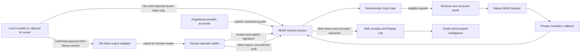
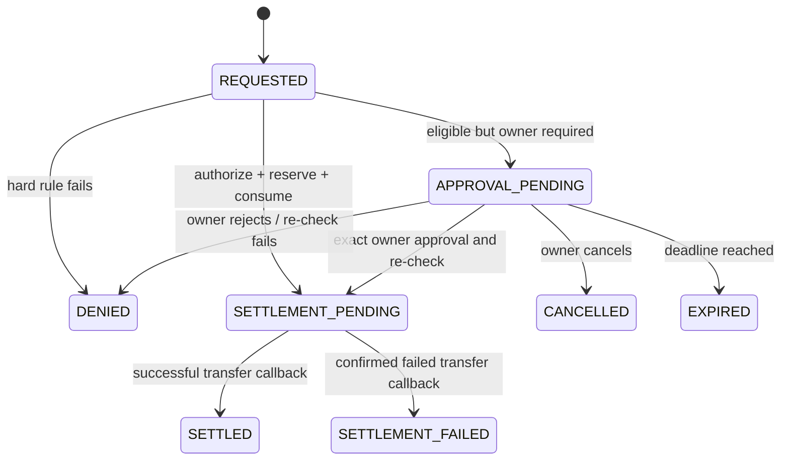

# RunLatch — implementation architecture

**Prepared:**3 November2026; reconciled7 November. **Status:** schema2 backend/agency report, local policy workshop and registered-quote LOCAL observation implemented. Type/lint/build,115 backend Node/67 frontend Node/73 Chromium browser/15parity and147 Rust/SDK pass. Actual LOCAL Sandbox evidence remains separate from SDK mocks and synthetic browser fixtures; the historical all-mode clone timed out and separate agency follow-up passed. Shared execution labels never verify a chain or grant authority. [Release record](docs/release/RELEASE_STATUS.md)/BUILD_LOG.md sections41–43 give exact checkout/privacy/licence/hidden-tab results. Latest contract additions are seven regression tests, not a new payment-authority path; full human visual review deferred, no public wallet/deployment evidence.
Authority: [direction brief](RUNLATCH_PRODUCT_DIRECTION_CHANGE_BRIEF.md) and compatible [original blueprint](RUNLATCH_PROJECT_BLUEPRINT.md); current choices below. Section18 specifies the new contract extension. Historical version candidates are not installed capabilities.

## 1. Smallest complete system

**Receipt/intelligence addition,8 November:** `src/lib/intelligence/receipts.ts` reuses the bounded LOCAL importer/report to bind policy-version/hash, owner-labelled resource/research task checks, provisioning/acceptance, request/resource and timestamps. It returns separate authorization/submission/settlement/completion/validation axes, with missing references unavailable. `summarizeOutcomes` deduplicates exact snapshots, rejects conflicts, filters inclusive integer times, derives only transfer+successful-callback matched provider spend, and supplies the existing exact cohort reducer. Inconsistent/unverified settlement excludes cost facts; failed/error spend stays in the success-cost numerator. Canonical predecessor comparisons require unchanged comparable terms. `/intelligence` is a memory-only client view, with separately labelled illustrative source and manual UNATTESTED checks that cannot replace canonical outcomes or feed analytics. No contract/payment authority/package/signing/RPC added. [Reproduction boundaries](docs/OUTCOME_RECEIPTS_AND_INTELLIGENCE.md); section44 records exact tests rather than inheriting earlier counts.

One Next.js/TypeScript web project, one Rust NEAR contract, one local Node workflow runner with in-process demo provider adapters, a shared off-chain validator, and test fixtures. No database, indexer, public signing service, marketplace, or cross-chain payment dependency.

The planned public prototype is a **single-operator testnet agency workspace** (not deployed). The operator creates opaque projects and owns funded Client Work Capsules, registers providers and records reviewed evidence/acceptance. Separate scoped agent keys propose purchases; provider accounts publish immutable quotes. No multi-tenancy/custody guarantee.



The Gate is inside the contract. The app can explain/preview; it cannot authorize payment or change settlement state.

## 2. Decision record

| ID | Decision | Reason / boundary |
| --- | --- | --- |
| DEC-01 | Native NEAR on testnet only | Small real integration; USDC examples in the blueprint are illustrative. No mainnet spending |
| DEC-02 | Provider identity/recipient and quote terms immutable | No silent overwrite or agent-controlled routing; changed terms need a new quote |
| DEC-03 | Capsule policy immutable and project revision bound | New scope requires new reviewed capsule/hash; owner project status/revision invalidates old requests/approvals, not silent policy changes |
| DEC-04 | Create and fund capsule together; storage credit separate | No unbacked allocation; zero-deposit agent requests need pre-funded bounded state |
| DEC-05 | Separate agent account, bound public key, restricted function-call key | No owner/provider/deployer authority in the runner; key gas allowance is not the purchase budget |
| DEC-06 | Approval pending holds no funds or quote | Avoid hold/cancellation complexity; approval re-checks then reserves atomically |
| DEC-07 | One-use quote consumed when transfer is authorized | Includes pending/failed payments; no automatic repayment with an old quote |
| DEC-08 | Native transfers plus small private callbacks | Pending is explicit; actual promise results resolve once; unknown outcomes remain quarantined |
| DEC-09 | Local runner; public web has no shared signer | Avoid exposing a gas/spending endpoint and a new auth/relay service |
| DEC-10 | Fixed local checks plus owner-attested evidence and separate human acceptance | Research checker retained; primary deployment/resource checker added without arbitrary fetch/oracle claims |
| DEC-11 | Unused-fund return only through a separate close operation | Safe end of pre-funded loop; not a quality-dependent refund or generic withdrawal API |
| DEC-12 | Basic cohort analytics, no database | On-chain records plus imported evidence suffice for the small demo; include failure costs |
| DEC-13 | Plain tables/CSS/static fills first; dithercn central | Avoid Motion/TanStack/Recharts and other optional packages until justified |
| DEC-14 | Intents/Chain Signatures/TEE deferred | No required cross-chain/private-compute problem; live rules say Intents has no testnet |

These are proposed implementation choices, not capabilities already shipped. Changing a decision requires updating related tests/docs and recording the reason, not silently widening scope.

## 3. Audit-based tool/dependency plan

The following are historical audit candidates, not current install status: Node24.20.0/npm11.19.0/Rust-Cargo1.99.0/WASM target existed; NEAR tooling/WSL/Docker were absent. Autonomous local work is now authorized. Pinned SDK/portable cargo-near are installed and tested as recorded in BUILD_LOG; other proposed packages are not assumed installed.

| Component | Candidate checked in audit | Purpose / admission gate |
| --- | --- | --- |
| Next.js + React/React DOM | 16.4.4 + 19.3.1 pair | One UI/SSR project; satisfy engines/peers and smoke-test together |
| TypeScript | Version not frozen | Strict schemas/types; select a supported tested version at scaffold time, not an unverified latest |
| Tailwind + PostCSS adapter | 4.3.4 pair | CSS/theme/layout; required v4 direction for dithercn |
| shadcn CLI | 4.23.0 | Copy only necessary reviewed primitives; components.json and license/change review required |
| dithercn | Source registry, no package version frozen | Engine and selected treatments in src/lib/dither; review/pin source and notices before approved installation |
| Zod | 4.6.7 | Off-chain policy/artifact schema checks; not payment authority |
| near-api-js | 7.4.0 | Current v7 views/status and local restricted-agent calls; published Node engine >=22.22.2 |
| @hot-labs/near-connect | 0.12.0 | Preferred human wallet connector; client-only initialization and actual testnet wallet/CSP verification |
| near-sdk | 5.30.0, Rust minimum 1.95 | Contract state, host APIs, promises, and local unit harness; build/runtime compatibility unproven |
| cargo-near / near-cli-rs | 0.22.0 / 0.30.1 | Official build/interaction tools; review official Windows artifacts and checksums before separate install approval |
| near-sandbox + Rust near-api | 0.4.0 + 0.8.7 | Official current integration-test direction; needs an approved Linux environment |
| Playwright test | 1.64.1 | Browser regression/keyboard/responsive/reduced-motion tests after web setup |

`function-call-key-plugin@2.1.0` expects NEAR Connect ^0.11.1, not 0.12.0. Do not force peers or install both automatically. The baseline scoped runner does not need that browser-login plugin; provision its restricted key through a separately approved human flow. A later browser key flow needs a verified compatible pair (the audit found connector 0.11.4 in the compatible series) and explicit consent.

Before any dependency addition: explain need, exact version/peers/engine, license, source changes, and alternatives. Pin the tested combination/lockfiles. No install, migration, account/key setup, or tool/security-policy change is implied by this plan.

## 4. Components and repository plan

The tree mixes existing contract/validator/harness files and planned frontend/evidence modules; see BUILD_LOG.md for actual files:

```text
RunLatch/
  AGENTS.md, BUILD_LOG.md
  RUNLATCH_PROJECT_BLUEPRINT.md, HACKATHON_COMPLIANCE.md
  PRODUCT.md, DESIGN.md, ARCHITECTURE.md, ACCEPTANCE_TESTS.md
  package.json, package-lock.json, components.json
  .gitignore, .env.example, README.md, LICENSE, THIRD_PARTY_NOTICES.md
  contracts/runlatch/
    Cargo.toml, Cargo.lock
    src/lib.rs, model.rs, gate.rs, settlement.rs
    tests/                         # bounded unit/Sandbox cases
  src/
    app/                           # landing, runs/detail, providers, lab, intelligence
    components/ui/                 # only used shadcn primitives
    components/runlatch/            # board, quote, trace, receipt, owner controls
    lib/near/                      # public config, final views, wallet boundary, status mapper
    lib/schema/                    # policy/proposal/receipt DTOs
    lib/validation/                # same deterministic off-chain checks in CLI/browser
    lib/preview/                   # explicitly simulated policy preview, never authorizer
    lib/dither/                    # reviewed engine source after approval
  scripts/workflow/                # local runner, fixtures, scenario commands
  fixtures/                       # harmless versioned data and cross-language vectors
  tests/                          # TS, browser, schema, receipt/analytics cases
  evidence/                       # reviewed public demo evidence only, never secrets
  public/fonts/                   # licensed assets, not third-party remote calls
  .agents/skills/                  # optional reviewed project copies after approval
  .local/                         # ignored private artifact outputs, never credentials
```

- **Contract:** all protected state and payment logic; bounded views expose canonical records.
- **Web:** reads records, presents exact signing reviews, validates files, displays source/settlement/validation separately. Owner/provider changes use human wallet consent, not a server key.
- **Runner:** manually started locally after explicit bounded testnet-run approval. It holds only the approved scoped agent key in process environment, calls only submit_purchase, and waits for evidence before using a fixture service.
- **Providers:** in-process demo adapters keyed by a registered service/quote; no third-party vendor/payment compatibility claim or production paywall.
- **Validator:** fixed schema/count/syntax checks; no arbitrary URL fetch in v1, no model judgement or browser HTML execution.
- **Receipts/intelligence:** small projections over canonical views and verified execution outcomes, not a new source of payment authority.
- **Public Replay Lab:** interactive local previews and inspectable testnet scenario records; a real execution is started through documented local commands, not a publicly exposed shared spending button.

## 5. Actors and access control

| Actor | Allowed authority | Forbidden delegation |
| --- | --- | --- |
| Operator / capsule owner | Configure/fund capsules, register/suspend providers, exact approvals, pause/resume/revoke, attest validation, close unused funding | These methods never belong to the AI key |
| Provider publisher account | Publish new immutable quotes for its own registered provider | Cannot rewrite registration/recipient, another provider's quote, or capsule policy |
| Agent account + bound public key | Submit proposals under its exact capsule | No direct transfers, funding, provider edits, approval, validation attestation, closing, deployment, or key management |
| Contract itself | Private resolution callbacks with actual promise context | No public or owner-supplied “mark settled/failed” method |
| Deployment account controller | Human retains administrative deploy/recovery keys | Explicit trust assumption; never promise immutable/trustless custody while those keys can replace code/move account funds |
| Visitor | Read public safe records, local preview, inspect/copy non-secret scenario commands | No shared signer or automatic paid endpoint |

The operator is fixed at initialization for this MVP; it is also the capsule owner. Do not build multi-user registry governance, owner transfer, or a general ownership framework.

Authorize direct actions with the intended predecessor account. submit_purchase also checks the original signer is that direct agent account and its public key matches the capsule, preventing a proxy from inheriting signer authority. Callbacks require predecessor == current contract, the expected operation, and exactly one native-transfer promise result.

Sensitive human methods require a deposit-capable key (the current one-yocto pattern, verified at implementation); capsule funding/provider storage operations have explicit deposits. The agent method requires zero attached deposit. One-yocto deposits are operating contributions, not new capsule allocation. Human recovery access remains outside the runner; never delete full-access keys or install null/unlimited gas allowance as a shortcut.

## 6. Canonical data and limits

| Record | Required fields / meaning |
| --- | --- |
| Contract configuration | Operator account, configured testnet tag, schema version, bounded provider/capsule indexes, operating/storage funding |
| RunCapsule | ID, operator owner, task/workflow IDs, agent account/public key, immutable policy/hash/schema version, validation-spec hash, created/expiry timestamps, lifecycle, original budget, net allocated, spent, reserved, returned amount, storage credit, request index, optional final outcome/refund record |
| Policy | Project ID/creation revision, native original funded cap, immediate purchase cap/full commitment cap, exact scopes/key, expiry and criteria; recurring forbidden or exact human review (default for revised demo) |
| Provider | Stable ID, publisher account, pinned recipient account, active/suspended status, minimal harmless metadata reference |
| ProviderQuote | Globally unique namespaced ID, provider/publisher/recipient, service/category, positive quantity, positive integer price, native asset, recurring flag, expiry, schema version/hash, OPEN or CONSUMED, consumed-by operation; optional previous quote reference |
| PurchaseRequest | Capsule/request/quote IDs, expected quote hash, immutable proposal/request hash and canonical quote snapshot, policy hash/version, bound agent, requested/deadline timestamps, decision/check trace/reasons, state, reservation amount, optional exact approval metadata, resolution observation |
| RunOutcome | Capsule + validation-spec hash, artifact hash if available, evidence hash, validator ID/version, PASS/FAIL/ERROR and objective reason/count summary, owner attester, chain recording timestamp; immutable |
| OwnerRefund | Internal operation ID, canonical capsule/owner/amount, pending/succeeded/failed observation and timestamps; separate from provider purchase spending |

Money uses checked u128/SDK token values internally and decimal strings in JSON; timestamps use chain nanoseconds and JSON strings for u64 values. No float conversions for authority/accounting. Amounts are positive, per-purchase/full-commitment caps <= original budget, approval threshold (if present) <= full-commitment cap, scopes nonempty/distinct, expiry future at creation, and agent/public-key/account formats valid.

**Proposed defensive ceilings, tune only after measurement/review:** 64 capsules, 3 providers, 32 quotes/provider, 32 requests/capsule, <=3 allowed providers, <=4 services/categories, page size <=20, raw opaque IDs <=64 ASCII bytes, composite IDs <=160 bytes, external artifact <=1 MiB, report 20–50 sources, URL <=2048 characters, title <=256, summary <=2048. Bound all other strings and lists similarly. These are design limits, not benchmark results or a protocol guarantee.

The operator funds capsule storage credit sized for its maximum requests/outcome/refund metadata; providers fund bounded quote storage. Pre-allocate or charge correctly before growth. Use unique collection prefixes and bounded enumeration. Callback resolution updates existing bounded records; no expensive logs, untrusted payload loops, large deserialize, or unbounded vector cleanup in the callback.

## 7. Hash and proposal binding

Use SHA-256 of a domain-separated, versioned **typed canonical encoding**, not arbitrary JSON.stringify output. Proposed implementation: Borsh-encoded structs with fixed field order and reviewed goldens for quote/policy/request; use audited encoding rather than inventing a new cryptographic format.

- Quote hash binds domain/schema, configured network tag, current contract ID, quote/provider/publisher/recipient IDs, service/category, quantity, asset, price, recurring flag, expiry, and any versioned previous-quote reference.
- Policy hash binds owner/capsule/agent account/key, task/workflow, exact limits/scope/expiry, and validation-spec hash. Schema v1 is not a mutable authority revision; new policy configuration has a fresh capsule/hash.
- Request hash binds capsule/request/quote IDs, canonical quote and policy hashes, authorized agent identity, created time, and canonical approval deadline.
- Protocol domain identifiers stay stable if the public brand changes. Network tags are binding metadata, not proof of network identity; separately verify RPC chain/network.

**Schema2 proposal fields only:** capsule_id, request_id, quote_id, expected_quote_hash, project_id, project_revision. Capsule/policy contains its immutable creation revision; project record contains current revision. Existing request_id is the payment idempotency key (one native attempt per intent); no redundant execution ID. No free provider/recipient/price/quantity/resource argument drives payment. Strict nested inputs and bounded IDs/hashes/time apply.

All4 proposal IDs are bounded safe ASCII before any denial persistence. Expected quote hash is capped at64 bytes before hashing/storage; malformed hashes within that bound fail Gate matching, whereas oversized strings reject the transaction with no surviving request. Common bounds apply to submit and preview. This protects prepaid history as well as money authority.

Tampering in Replay Lab changes the displayed quote copy and its expected hash; the contract rejects that hash against stored canonical terms. Raw injected payment fields are invalid proposal/ABI input, not a supported alternate routing path. An ignored outer wrapper field must never affect settlement, and must not be represented as a stored business denial unless the ABI actually rejects it. Preserve this distinction in tests and demo narration.

## 8. Quote lifecycle

1. Operator registers immutable publisher and recipient (normal demo providers may use the same account); only status can subsequently change.
2. The publisher authenticates publish_quote. Verify provider ownership, recipient equality to registry, supported asset, fields, uniqueness, bounds, and storage funding.
3. Store canonical terms/hash with OPEN state. Account-ID format validation is not proof that a recipient account currently exists; recipient preflight may use RPC, but actual transfer outcomes decide settlement.
4. Expiry and provider suspension affect eligibility dynamically. Published terms do not change; price/quantity/service updates require a fresh quote ID. A history link is accepted only for the same provider and a comparable service/asset/quantity.
5. Approval pending does not consume/claim a quote. At authorization, re-check it and atomically set CONSUMED with capsule/request binding before the transfer promise.
6. Consumption is permanent even when transfer fails. A retry needs a new quote and request; it is not an automatic renewal or reuse mechanism.

A canonical recurring quote carries fixed-term commercial terms. Explicit Forbidden policy hard-denies it; RequireApproval policy permits only bounded eligible commitments after exact owner review. Indefinite/unknown/no-cap exposure is denied, not approved from an explanation. Only the initial transfer is scheduled: no recurring collector, renewal authority or supplier cancellation. Legacy research recurring fixtures remain hard-denied.

## 9. Deterministic Gate and denial records

Ordered checks: bounded input/known funded capsule -> exact direct identity -> project association/status/current revision -> capsule active/expiry -> replay/capacity -> canonical quote/hash/provider/recipient/expiry/use -> asset/scope/quantity -> fixed-term/unknown exposure and recurring policy -> exact canonical project resource duplicate -> hard immediate/full-commitment caps -> available-now/available-to-commit -> exact owner approval. Additional checks are Rust enforcement, not just frontend warnings.

Use stable reason codes such as UNAUTHORIZED_AGENT, CAPSULE_INACTIVE, CAPSULE_EXPIRED, UNKNOWN_QUOTE, QUOTE_TERMS_MISMATCH, PROVIDER_NOT_ALLOWED, PROVIDER_SUSPENDED, QUOTE_EXPIRED, QUOTE_CONSUMED, SERVICE_NOT_ALLOWED, QUANTITY_LIMIT_EXCEEDED, RECURRING_FORBIDDEN, PURCHASE_LIMIT_EXCEEDED, INSUFFICIENT_AVAILABLE_BUDGET, REQUEST_REPLAY, APPROVAL_EXPIRED, and OWNER_REJECTED. A trace marks checks passed/failed/not-evaluated, never inventing results for missing data.

- Malformed/unauthorized/unknown-capsule calls fail before storage growth; their execution failures are evidence, not persisted purchase records.
- A new validly identified authorized attempt that violates business policy can persist a bounded DENIED request and return structured reasons with **no transfer promise**.
- A duplicate request ID returns a replay-denial result/event referencing the original, without overwriting its approved/pending/settled record or reserving again.
- A successful blockchain transaction can contain a DENIED business result. The UI must decode the result/record, not map transaction success to purchase approval.
- A read-only preview reuses Rust evaluation with explicitly supplied proposed agent identity; it grants nothing. Hypothetical browser budget edits use the labelled TypeScript local preview and shared parity fixtures, not mutation.

## 10. Purchase and approval lifecycle



REQUESTED, AUTHORIZED, and RESERVED are conceptual/event milestones. Authorization, reserve, consumption, and scheduling happen in the **same initiating receipt**; durable public state normally becomes SETTLEMENT_PENDING. Do not create fake delays or separate public authorize/pay methods.

The approval deadline is the earliest of quote expiry, capsule expiry, and a fixed bounded approval TTL (proposed v1: ten minutes). The pending request/hash is immutable. approve_purchase carries IDs and the expected request hash from the signing review; owner, deadline, policy/hash, quote/hash/lifecycle, provider status, capsule state, and budget are re-checked at the moment of authorization.

Approval is required when full canonical commitment is strictly above the configured threshold, or a new fixed recurring commitment uses RequireApproval policy. Equality does not trigger the numeric rule; absent threshold does not waive recurring review. Zero reviews every eligible positive commitment. Hard denials never reach approval.

One pending request approved first can consume a quote another pending request references. The second then fails safely. Another authorized payment can use capacity while approval waits. Reject/cancel/expiry of approval-pending requests changes no money because no hold existed.

Terminal request IDs cannot become authorizable again. Owner approval cannot cure unknown/tampered/consumed/disallowed/expired terms, increase the hard cap, or revive revoked authority. Owner may still reject/cancel a stale pending request after capsule suspension; that operation cannot release an unrelated payment/refund reservation.

Expiry uses chain time. Views may expose stored state plus effective expiry; reads do not secretly write a new EXPIRED receipt. Authorization always checks current time. No scheduler or timeout-driven money release is needed.

## 11. Funding, reservations, and asynchronous payment

Let B = original funded purchase budget, A = current net allocated, S = confirmed provider spend, R = pending purchase plus owner-refund reservations, F = confirmed returned purchase funds.

Required invariants after every committed receipt:

```text
available_now = A - S - R
available_to_commit = A - S - R - C
S + R + C <= A <= B
A + F = B
R = sum(pending purchase amounts) + pending owner-refund amount
```

Storage credit and transaction gas are not B/A/S. create_capsule accepts exactly reviewed purchase funding plus separate required storage credit; no arbitrary crediting from request amounts. No top-up/in-place budget expansion in v1.

**Authorize purchase:** validate all current rules and liquidity/storage; add canonical due-now to R and future portion(total minus due-now) to C; atomically claim the canonical project resource, consume quote and schedule one native transfer/private callback. No free amount/recipient/fingerprint or duplicate check-then-send gap.

**Successful resolution:** actual successful transfer callback moves due-now R to S once and retains C/resource. **Confirmed failed initial transfer:** releases only that request's R and C, with canonical terms explicitly making any future demo obligation conditional on initial payment; exact resource claim may then be removed if still owned by this request. No provider contract is claimed before payment. Unknown/failed callback retains R/C/resource. Quote remains consumed; retry needs new request/quote.

**Unknown/unreadable/missing/invalid result context:** do not treat it as confirmed failure or successful payment. Retain R/pending state and surface reconciliation needed. Callback failure is not automatically retried and can strand a reservation. No public recovery method or arbitrary operator “failed” assertion is authorized by this MVP; evidence-backed recovery requires a separate reviewed design. Document this limitation explicitly.

Keep callbacks private, small, bounded, and non-panicking on expected failure. Check expected result count/operation/state; use actual native-transfer result inspection rather than assuming transfer return bytes are JSON. Measure worst-case gas including large allowed state and the failure branch, then reserve a clear margin. Precise SDK result/liquidity APIs must be verified and build-tested, not guessed from old examples.

Never count an already scheduled outgoing transfer as still-liquid collateral, reclaim pending funds on revocation, infer failure from RPC timeout, or retry with a fresh request merely because the browser lost its response. Preserve the signed transaction/request identity and inspect actual outcomes first.

## 12. Capsule completion and unused-fund close

Stored capsule states: ACTIVE, PAUSED, REVOKED, COMPLETED, CLOSING, CLOSED. Effective EXPIRED applies to uncompleted ACTIVE/PAUSED capsules after their deadline. Revocation is irreversible **authorization**: later outcome/closing bookkeeping is allowed, but never ACTIVE again.

- Owner pause/resume works only in eligible unexpired/uncompleted states. Pause/revoke does not cancel a submitted transfer.
- record_validation requires owner, exact criteria hash, a bounded final report, no pending purchase/refund, and no prior final outcome. It records the owner-attested report and stops future purchases (COMPLETED unless already CLOSED). It cannot set payment outcomes or broaden policy. Closed/revoked/expired runs can receive a final report without regaining authority.
- close_capsule requires owner, inactive authority, and no unresolved R. Approval-pending requests cannot later authorize after close and hold no funds.
- Derive unused amount from A-S-C, never a caller amount/recipient. Retain C collateral; closing cannot cancel external obligations. If zero, close without transfer. Otherwise reserve only reclaimable surplus and schedule one stored-owner transfer/private callback.
- Refund success: R -= amount, A -= amount, F += amount, S unchanged, state CLOSED. Refund failure: release only that confirmed-failed refund reservation, keep A/F/S unchanged, retain a failure record, set non-authorizing REVOKED. An explicit retry uses a new internal refund operation after checking the prior result; no automatic resend.
- Refund callback failure/unknown stays CLOSING/reserved and cannot trigger a second refund or reopen purchases.

Original budget/policy stay immutable; net allocation can decrease only on confirmed owner refund. UI explains original funding, net allocated, returned amount, and retained history/storage credit separately. This return is not triggered by task validation failure and does not recover an already settled provider payment. Storage credit remains allocated to retained history in v1; no generic storage withdrawal/deletion path.

## 13. Proposed contract surface

Names are a specification, not implemented signatures; adapt wrappers to verified near-sdk conventions without weakening semantics.

| Method / group | Boundary |
| --- | --- |
| init | One-time operator/testnet-tag configuration, human-controlled deployment |
| create_capsule | Operator-only reviewed immutable policy + actual purchase/storage funding |
| register_provider / set_provider_status | Operator identity/pinned recipient registration and suspend/reactivate status; no identity rewrite |
| publish_quote | Registered publisher only, immutable new canonical terms, funded bounded state |
| submit_purchase | Exact scoped agent account/key, strict IDs/hash, zero deposit; Gate and payment schedule in one receipt |
| approve_purchase / reject_purchase / cancel_purchase | Exact owner, stored pending request/hash/state; approval never bypasses hard checks |
| set_capsule_paused / revoke_capsule | Owner authority controls, no pending-fund release |
| record_validation | Owner attests one exact off-chain result; no oracle or payment setter |
| close_capsule | Owner-only unused-fund operation; no arbitrary withdrawal arguments |
| private purchase/refund resolution | Contract + exact promise context; update once; no external outcome setter |
| bounded get_capsule/get_capsules/get_provider/get_quotes/get_purchase/get_receipt/preview_purchase | Read-only canonical DTOs, source/block metadata where obtainable, pagination |

Emit short structured/versioned events for quotes, decisions, capsule changes, resolution, validation, and refund. Verify current NEAR event conventions before implementation. No raw prompts, credentials, artifacts, or long explanations in on-chain logs.

## 14. Validation, receipts, and metrics

### Off-chain validation v1

Proposed report schema: topic plus sources containing opaque id, URL, title, and nonempty summary. Require strict JSON, allowed fields/types, 20–50 records, distinct IDs and exact normalized URL identities, HTTPS scheme, and bounded values. The controlled fixture suite checks its deterministic expected fields/counts. “URL checked” means syntax in v1, not network reachability or research truth.

The proposed criteria ID is research-output-v1, as in PRODUCT.md. Topic, title, and summary must remain nonempty after trimming whitespace. The exact typed criteria/evidence encoding and hash golden values are implementation work, not values fabricated in this specification.

For URL identity, parse with the standard URL implementation, require a hostname and HTTPS, reject username/password credentials, remove the fragment, and compare the serialized result (host case/default-port normalization comes from the parser). Preserve path and query semantics; do not invent reachability checks or reorder query parameters. Private information in URL queries still needs human privacy review before any public artifact/evidence export.

Hash exact artifact bytes before parsing; do not accidentally reserialize and compare a different file. Criteria and validator IDs/versions plus their deterministic evidence encoding/hash bind the result. Report timestamps are observations, not independent execution proof. A PASS result requires an artifact hash; ERROR with no output explicitly records unavailable artifact, never an invented hash.

Validator logic is shared between local runner and browser import/inspection. The owner can review/attest the report through a wallet call. On-chain state establishes who attested those values; it cannot establish that the off-chain checker honestly ran or that its research is true. No extra oracle/key service is introduced.

**Implementation update:** research.ts/CLI implement v1 checks offline; attestation.ts prepares immutable bounded owner review. Reports stay LOCAL_VALIDATOR/UNATTESTED until an owner recording is actually observed. Rust record_validation/get_outcome/get_receipt and their LOCAL Sandbox regression pass; not an oracle/payment setter. Workflow CLI handles actual produced/missing files but its full restricted-key chain integration remains unverified; browser/wallet/TypeScript compiler checks unfinished. JSON validation hashes and contract Borsh hashes are different domains.

### Outcome Receipt projection

Include capsule/request/quote, policy/hash/version, canonical provider/recipient/asset/quantity/amount, check reasons and decision, reservation/settlement observation, actual transaction and receipt references when verified, task status, criteria/validator/evidence/artifact identifiers, owner attester if recorded, source, timestamps, and current block/freshness context.

Transaction submission status belongs to the off-chain observer until network evidence is available. Do not assume the contract knows its originating transaction hash; join request/event identity to actual wallet/runner RPC outcomes. No supplied tx hash can set on-chain settlement state.

For new business denials, use the persisted contract record. For replay/ABI/unauthorized attempts, use the actual execution return/failure and reference the unchanged original record if present. Deduplicate attempt identity by real transaction hash; never turn a retry response into a second paid receipt. Clearly mark an off-chain report as unattested until an actual owner attestation is confirmed.

Final UI/accounting requires final contract views **and** actual transfer/callback receipt outcomes. Pin related views/aggregates to the same known finalized block/hash rather than mix cached records from different points in a run. Prefer current send_tx/tx and `wait_until: FINAL` for accounting evidence; use tx_status only on supported nodes (nearcore 2.14+), otherwise the documented legacy receipt-status alias. Inspect node versions and the SDK's block-reference APIs at integration time. Timeout/unknown/untracked-shard responses remain unresolved, not failed payment. One green transaction status is not enough.

### Intelligence

Use the completed-cohort definition in PRODUCT.md. Integer purchase spend sums exclude gas/storage/returned funds, include completed failed/error-run costs, and divide by passed completed runs only within matching workflow/criteria/validator/asset/network. Represent the exact ratio internally; rounding is presentation only. Report exclusions and no-success as unavailable. Quote price-change comparisons require a real prior comparable quote; suggestions/reputation/notifications are deferred.

## 15. Modes, environment variables, and privacy

Variables are **planned names/placeholders**, not files or configured credentials. A future .env.example contains no real values. Never dump the environment to inspect a signer.

| Variable | Visibility / use |
| --- | --- |
| NEXT_PUBLIC_RUNLATCH_MODE | Public: local or testnet; local fixtures are explicitly simulated |
| NEXT_PUBLIC_NEAR_NETWORK_ID | Public: testnet only; reject mainnet/mismatch |
| NEXT_PUBLIC_NEAR_CONTRACT_ID | Public: actual verified account required in testnet mode; unset today |
| NEXT_PUBLIC_NEAR_RPC_URL | Public credential-free HTTPS testnet endpoint verified against official docs/network; never a token-bearing URL |
| RUNLATCH_AGENT_ACCOUNT_ID | Local runner: bound testnet account, not owner identity |
| RUNLATCH_AGENT_PRIVATE_KEY | Local runner process only: approved scoped key, injected privately; no file/log/browser/public-prefix exposure |
| RUNLATCH_ARTIFACT_DIR | Local output location, verified Git-ignored and not served; no credentials written there |
| AI_PROVIDER_API_KEY | Optional future proposal adapter, server/local only; no provider/model/API capability selected or required now |
| CARGO_TARGET_DIR | Optional build-output setting, isolated from unrelated projects; configure only after approval |

Local mode needs no keys/network and cannot manufacture chain evidence. Testnet mode requires verified public config and approved signer/account/deployment setup; missing/mismatched values disable real actions. The web build never imports runner signing code. Owner/provider/deployment keys are not environment variables for the app.

No public purchase-signing route or hosted agent key. Imported artifacts remain browser memory until explicit export; local output folders are ignored and never public. Only harmless fixtures/reviewed evidence may be tracked. Real report URLs/prompts can be sensitive; never put them in query strings, automatic browser storage, on-chain logs, or public screenshots. Arbitrary network URL checking is absent in v1; a later live checker needs allowlists, SSRF protections, limits, and new criteria/version tests.

## 16. Test and evidence plan

Current140 Rust/SDK and114 Node pass; recovered all-mode LOCAL Sandbox regression and strict lint/format pass on the rebuilt schema2 artifacts. Includes actual oversized-proposal rollback, core/outcome/fault/max/scoped/research/project-commitment/agency/report paths. Maximum sample:64 capsules/96 quotes/three full histories; enriched history124687 bytes, original history/refund aggregate166370 plus outcome10071 bytes;262144-byte reserve per capsule. Largest observed healthy callback5265058835466 of25000000000000 gas is the section24 measured sample, not a new measurement inferred from the later pass. Not all2048 histories or an exhaustive worst-case guarantee. Local frontend32 browser/22 Node and168-file fresh-source/npm-ci/type/lint/114+22 Node/build checks pass; no Git clone/fresh Rust environment or public testnet/release evidence. Counts are not accepted-case counts; see BUILD_LOG.md.

1. Rust unit tests: identity, canonical encodings, bounds, Gate, approval, arithmetic, replay, private callback result/state handling, and owner refund invariants; generated ephemeral test keys only.
2. Linux Sandbox integration: real WASM/account/action receipts, funded/unfunded creation, success/failure transfer, concurrency/interleaving, revocation after scheduling, callback gas failure/quarantine, refunds, and storage/gas worst cases. SDK unit mocks are not this evidence.
3. TypeScript/schema tests: exact money/time parsing, proposal/artifact limits, deterministic validation, preview parity vectors, receipt/transaction mapping, metric cohorts and ratios, secrets/config isolation.
4. Browser tests: actual interactions, correct network/caller/signing review, no shared public signer, state refresh/errors, real receipts, keyboard/contrast/reduced motion, layouts, dither fallback/pause, and no leaks.
5. Separately approved testnet checks: real contract/account/code hash, one settled purchase, several actual denied attempts through the same submit method, exact outcome/receipt/final-state references, and independent read-back. Local fault scenarios retain LOCAL labels.
6. Clean-checkout/release QA: installed-version docs and lockfiles, lint/type/build/tests, README judge path, source/licenses/no secrets, live compliance, screenshots/video, and human-only publication/submission approval.

No fabricated hashes, passing test counts, performance metrics, provider attestations, or deployment links. Approved WSL2 Ubuntu/Rust setup is complete and Linux unit/lint tests pass. Windows Application Control remains intact; SDK mocks cannot substitute for actual Sandbox receipts.

## 17. Delivery gates and residual risks

| Milestone | Small outcome | Gate |
| --- | --- | --- |
| M1: this stage | Six coherent planning documents, no implementation | Human reviews scope/decisions |
| M2: contract/toolchain foundation | Approved minimal Rust scaffold, toolchain smoke test, capsule/quote/Gate tests | Separate permission for installs/Git initialization; no deploy/signing implied |
| M3: contract funds lifecycle | Exact approvals, reservations, native callbacks, unused-fund close, adverse unit/Sandbox tests | Approved Linux environment; no UI-only enforcement |
| M4: one workflow and minimal app | Scripted proposal path, validator, owner attestations, accurate receipts/lab/intelligence | No mandatory AI key; explicit testnet setup/deploy/run approval before real evidence |
| M5: visual and release QA | Roster-informed RunLatch, central dithercn, accessibility, real evidence and clean-start README | Re-check live rules; publication/post/submission require separate human approval |

The 14 November 23:59 UTC deadline is an acceptance gate, not permission to skip consent/tests. Freeze extras early and leave QA/demo time. If settlement cannot be made reliable, show the smaller real authorization integration honestly and report incomplete MVP criteria rather than substitute a mock payment.

Open risks: sampled schema2 storage/callback costs are not exhaustive worst-case proof; wallet/testnet/scoped-key consent; no catastrophic recovery or verified supplier cancellation; licenses/name/eligibility; UI/type/build/browser/clean-checkout QA and public approval/evidence. Existing Linux/SDK/WASM foundation works. Protection is against the scoped agent, not malicious deployer/provider/owner-checker.

## 18. Direction-change schema2 — minimal extension

### Projects, revisions and allocation

- Bounded Project stores opaque project/organisation/client references, owner, immutable budget ceiling/expiry and outcome-definition hash, status/current revision and bounded capsule IDs. Names/personal details/full work orders stay off-chain.
- Project registration pays separate bounded storage, not a second purchase budget. Capsule creation attaches actual budget+storage; sum of original funded allocations across project capsules must never exceed project ceiling. Allocation is conservative/non-revolving: returned money does not replenish delegation capacity. Disjoint funded sub-budgets enforce the shared project ceiling without duplicating settlement ledgers or creating recursive children.
- Owner status updates use exact expected revision and one-yocto identity guard. Real status changes increment revision; same-status no-op does not. Cancelled/completed project cannot reopen. Pause/resume does not release pending transfers; previously bound capsules/approvals stay stale after revision changes. New authority requires a new owner-reviewed capsule against the new revision and remaining unallocated ceiling (or a new work order). No scope/budget edits or external-message authority.
- Policy and proposal both bind project ID/revision; current project status/revision checked at submit and approval. Schema version is serialization format, not authority freshness. Callbacks settle original operations even if project revision/state changed.

### Canonical commercial terms

- Quote schema2 binds plan/service, stable resource key, quote version/hash and a bounded optional commercial record: fixed one-time or fixed-term recurring, period count/cadence, per-period charge, explicit mandatory fees/taxes/setup, renewal/cancellation reference hash and evidence reference hash. Contract calculates total by checked arithmetic. All immediate mandatory charges are included in due-now; future portion is total minus due-now. Quantity is already included in canonical price, not multiplied again.
- Legacy no-commercial-record research quote is explicitly fixed/all-inclusive one-time price, not inferred unknown fees; recurring without bounded terms fails closed. Unknown/indefinite/variable pricing is rejected in MVP; caps for other rails remain deferred. No ability to guarantee a third-party usage limit/annual cost/FX rate.
- Fixed recurring minimum commitment = period charge × required periods + mandatory upfront charges. Initial due-now = first period + upfront charges. Current supported terms exclude introductory-rate schedules/renewal execution; changed terms require new quote and decision. No unbounded auto-renew execution.
- Duplicate fingerprint hashes project + canonical provider + service/plan + stable resource key. Quote ID and price are deliberately excluded so fresh/changed quote cannot buy the same resource again. Capacity claims exist only after authorization, not during approval wait; settlement failure may release only the exact contingent fixture claim. Settled/unknown claims remain, including failed provisioning.

### Evidence, acceptance and report

- Keep native settlement callback authoritative. Add bounded owner-recorded provisioning report with declared source(trusted fixture/application observation, not forged provider signature), exact policy/request/quote binding and off-chain evidence digest. Distinct task checker report and HumanAcceptance record bind expected outcome/evidence hash, authorised human/time. The agent cannot set either; accepting a result never changes payment or releases C.
- Fixed website/resource fixture check validates a bounded expected JSON manifest/health observation, with timestamp/tool/criteria/pass/fail/error and exact artifact hash. It is LOCAL fixture checking, not external HTTPS reachability or a real database. Existing research validator remains separately versioned/tested.
- Project report derives totals/rows from canonical bounded snapshots and joined actual RPC outcomes; selected single-project export defaults to no account IDs, private labels/prompts/artifacts/URLs or transaction links. Owner explicitly selects budget/expense/evidence disclosure. No public report link/token, client login, telemetry or automatic upload. Public on-chain data is not made confidential by this export filter.
- Schema2 capsule storage reserve262144 bytes independently pre-funds32 purchase/resource entries, up to64 provisioning events, one bounded task/research result and explicit acceptance. Project/provider/quote storage credits stay separate. Expanded runtime measurements in BUILD_LOG, not a production/storage guarantee. No private state deletion/withdrawal route.
- Native NEAR units only.300/50/20/240 are demo ratios, not dollar equivalents; full exact amounts shown. No AP2/network integration claim without implementation/conformance tests.

### Migration and evidence boundary

No public state exists. Current schema2 default/fault WASM builds and fresh ephemeral Sandbox regression pass; baseline hashes/results remain historical, not new-build proof. No automatic migration/upgrade or public fault deployment. Local R/S/C/resource/owner-return/bounds regression is recorded in BUILD_LOG.md; further contract changes require fresh applicable tests. Public-network claims require separately approved evidence.

Official docs re-read for this specification: https://nearhackathon.com/HACKATHON.md, https://docs.near.org/protocol/accounts-contracts/access-keys.md, https://docs.near.org/smart-contracts/security/cross-contract-calls/callback-failures.md, and https://docs.near.org/api/rpc/transactions.md. Context7 was also queried for near-sdk callback/unit context and dithercn rendering boundaries. Other audit sources/version checks are recorded in HACKATHON_COMPLIANCE.md; re-verify at implementation, not by memory.

## 19. Local frontend boundary — 7 November

One Next App Router npm root, static landing/docs/read-only seeded workspace and isolated client controls. No browser imports of signing/workflow CLI modules, live RPC call or server action/purchase endpoint. .local reports/keys/artifacts are never served. Curated /docs is authored public technical explanation, not arbitrary workspace-file access.

TypeScript preview reuses exact commitment/accounting/hash modules and a29-check view evaluator.15 actual existing Rust Gate vectors match all check states/reason order/decisions via a standalone Linux adapter; this is sampled LOCAL logic parity, not contract storage/identity proof or formal equivalence. Demo quote domains/account-like labels are fictional and never explorer links. No browser mutation of trusted quote, policy, settlement or human acceptance.

Static dither/font/brand assets are self-hosted; no runtime third-party widget/hotlink/telemetry. Theme/texture settings are memory-only display state, not financial authority. The linked “Built with” strip labels real tools/LOCAL NEAR scope and is not a partner/provider listing. Landing/report values are explicitly seeded; project report preview downloads selected fictional JSON, not an authenticated owner/client-sharing service. Real report reducer/Sandbox evidence remains separate.

Versions/source/licenses and current verification are in package-lock.json, THIRD_PARTY_NOTICES.md and BUILD_LOG.md. Source changes in contract/validator/report/harness remain preserved; UI QA does not replace140 SDK/current Sandbox evidence or authorize public-network action.

## 20. Requested local policy workshop — 7 November

`src/lib/policy/` implements bounded purchasing terms, explicit-clause compilation, strict untrusted JSON/manual validation and exact-context local review/versioning. `/policy` is linked from `/demo`; eight immutable in-memory versions require explicit review of every term and pinned fixture recipient. Editing invalidates draft review, not prior versions. No purchasing term supplies a recipient, owner/agent key, AI authorization decision or mutable capsule authority.

The optional caller-injected `PolicyDraftAdapter` is a tested draft-only seam, not a configured hosted LLM. No key is required and nothing is automatically uploaded/persisted. Purchasing terms omit mandatory deployable Rust Policy bindings; browser-local approval is not authenticated owner activation. Real authority still requires owner-reviewed capsule creation/funding and the `runlatch.policy.v2` Borsh path. Compiler review serialization is deliberately separate. [Policy workshop](docs/POLICY_WORKSHOP.md) and BUILD_LOG.md section42 give grammar, limits, adverse tests and exact evidence. No Rust change or new spending path accompanies this feature.

## 21. Registered-quote LOCAL observation — 7 November

The existing agency harness registers controlled database/hosting quotes plus a labelled failed-payment fixture. Its scoped agent obtains a registered quote and submits project/revision, capsule, request, quote and expected quote hash only. Rust loads canonical provider/recipient/asset/amount/commercial terms and rechecks current authority; the browser cannot substitute a receiver or amount.

`src/lib/near/records.ts` bounds JSON bytes/depth/duplicate keys and canonical DTO fields. `observation.ts` revalidates registry/hash/report/binding/accounting consistency and joins exported initial transfer and successful private-callback outcomes to each purchase. A reported settled/failed record without matching evidence stays `SETTLEMENT_UNVERIFIED`; labels, hashes and input-derived ledger totals do not independently prove a chain. Reused receipts, mismatched transfers and duplicate payment attempts fail closed. Replay attempts preserve the original purchase.

`/demo#contract-observation` is an explicit browser-memory file import, not an RPC/indexer/server endpoint. Clear/replacement invalidates drafts/review and discards late read results; no upload, persistence, automatic private-file access or purchase execution. Event milestones REQUESTED/AUTHORIZED/RESERVED/scheduling remain distinct from durable purchase status and payment evidence. Revocation changes authority, not the outgoing transfer outcome. Approval-pending holds nothing; timeout/expiry/revocation/UI error cannot release a scheduled reservation or trigger a resend.

Unsigned proposal and exact historical owner-review views always leave signing disabled. NEAR Connect is intended but not installed/connected; no owner-signature fallback, browser-generated agent key or public target is configured. [Reproduction and evidence limits](docs/CONTRACT_OBSERVATION_DEMO.md), BUILD_LOG.md section43 and the release record distinguish SDK/parser/browser tests from actual LOCAL Sandbox artifacts and absent public-testnet proof.

## 22. Working testnet MVP — first-stage read-only foundation (8 November)

The human requests this MVP first and a separately approved Replay Lab second. [Active plan](docs/WORKING_TESTNET_MVP_PLAN.md). `src/lib/near/testnet-rpc.ts` now exposes explicit preflight and owner-selected project reads only: named `.testnet` contract/operator, credential-free official RPC allowlist, expected code hash, final block pin, chain/sync/operator/schema/network/storage checks, bounded bytes/calls/time and cancellation. No signer, broadcast, arbitrary RPC/view dispatcher, browser storage or automatic network call is exposed. Injected transports carry an explicit unverified test label; RPC readback is not a light-client proof or signing consent.

Selected capsules/providers/quotes are bounded, internally bound and checked against the same block. The existing canonical project-report reducer checks integer ledger/operation sums and explicit disclosure. Reported settled state stays `UNVERIFIED_WITHOUT_TRANSACTION_TRANSFER_CALLBACK_READBACK` until a separate transaction/action/outcome observer is implemented and actually run. The existing LOCAL importer still rejects testnet-labelled files; no relabelling through the LOCAL parser. Wallet, restricted local agent, public accounts/deployment and complete testnet vertical slice remain unfinished. No Rust or dependency change accompanied this first backend stage.

**Second backend stage:** `observePurchase` now performs a bounded one-transaction RPC lookup and `testnet-evidence.ts` validates exact call/graph/transfer/private-callback data dependency, initiating/callback historical code hashes and final record/timestamps/future commitments. Views are re-pinned after lookup. No-payment, replay-preserved original state and actual rolled-back failure remain separate from payment. Missing/failing callback evidence retains reservations and cannot release/resend. All evidence remains RPC-reported/unverified-by-light-client; injected transports are explicitly not chain evidence. [Detailed semantics and limits](docs/TESTNET_SETTLEMENT_OBSERVER.md). This local implementation has only synthetic tests so far, not public execution, browser integration or signing.

**Review/access foundation:** `readPurchaseReview` pins an unsigned submit/exact-owner-approval call, current canonical snapshot/quote/ledger and full integer exposure. `readRestrictedAgent` checks the separate ordinary function-call key, one receiver/submit-only methods/finite positive capped gas allowance, exact nonce/list agreement and distinct recovery key presence. Fresh in-memory confirmation invalidates changed authority/call/state/key/transport or expired review; it is not authentication or Gate approval. Shared target parsing moved unchanged into `testnet-target.ts`; no replacement Rust policy engine. [Semantics/limitations](docs/TESTNET_ACTION_REVIEW.md). Source-reviewed connector/SDK candidates remain uninstalled because default remote wallet code/storage and SDK retry behavior require a narrower admitted path; licence review pending. No signing/administrative/provider integration or deployed evidence exists.

**Offline single-attempt groundwork:** Node-only `scripts/near/` uses the existing issued review and observation-intent parser, exclusive local request markers and identity-before-test-invocation ordering. Deadlines/cancellation/unknown results retain identity/claim; no retry/reset/money mutation. HTTP-labelled reviews and owner calls are rejected; trusted injected test ports have no default signer/codec/broadcast. The namespace/path/junction/lease tests are local filesystem samples, not tamper-proof storage or power-loss guarantees. [Scope and limitations](docs/LOCAL_SINGLE_ATTEMPT_EXERCISE.md).20nearNode/136frontend/115backend/type/lint pass; no browser/build/SDK/Sandbox/public evidence. [Candidate graph review](docs/SDK_TRANSITIVE_SOURCE_REVIEW.md) covers integrity/metadata/notices and selected source behavior, not every source line or security/legal clearance; dependency admission remains pending two exact notice gaps.

**Owner/provider setup review:** `setup-review.ts` parses the actual four schema2 creation/publication calls; `readSetupReview` reuses final-block preflight and fixed project/capsule/provider/quote plus selectedpublichuman-key views. Complete immutable policy and exact derived deposits are detached/frozen. `review-content.ts` shares bounded unsigned-content hashing with purchase review; this is not contractpolicyBorsh or a second Gate. In-memory exact fresh confirmation leaves signingdisabled. Global quotas/interleavings, actual human authentication/signing, state activation, payment/provisioning and recipient existence are not established. [Scope and limits](docs/TESTNET_SETUP_REVIEW.md). Source-matching supplementalbs58notice now located; near-seed-phrase remains unresolved and SDKuninstalled. No Rust/lock/UI/wallet/broadcast/newpaymentauthority changed.

**Owner/outcome review:** `owner-review.ts`/`outcome-input.ts` and `readOwnerReview` add only fixed unsigned schema2 controls/close/evidence/task/acceptance calls. Current key/project/snapshot are final-block pinned; complete integer accounting reuses the existing report reducer. Exact task report is recomputed from explicit memory-only bounded artifact, never uploaded. Potential close amount is unused-to-commit, not a quality refund or scheduled transfer. Local fresh confirmation is not an atomic lease; only existing Rust signatures enforce optimistic hashes/revision where present. All settlement remains unverified without the observer, signing remainsdisabled. Legacyresearchoutcome snapshots explicitly declined by this new resource seam; regression unchanged. [Scope/limits/tests](docs/TESTNET_OWNER_OUTCOME_REVIEW.md); no new dependency/Rust/UI/authority path.

**Node wire groundwork:** original Node-only `scripts/near/{base58,transaction-codec,signature-envelope}.ts` admit ordinaryV0 only, onezero-deposit `submit_purchase`, bounded canonical arguments/decimalnonce/gas. SHA256/Ed25519 use Nodebuilt-ins; public JWK import/strict byte decoding plus24RustSDKwire/hash comparisons and one ephemeral signature verify exactbytes, not chainauthority. `local-signing-exercise.ts` generates only ephemeralprivateKeyObjects in memory and rejectsHTTP/ownerreviews; existingjournal capturesactualpublicidentity beforeoneofflineinvocation. No suppliedsecret/keyloader/publicnonceallocator/broadcaster/browserimport or Gate replacement; [limits/reproduction](docs/TESTNET_TRANSACTION_CODEC.md). RuntimeV1/SDKadmission/publicsigning and ownerwallet remainunfinished.

**Signed local composition:** `local-runner-exercise.ts` composes the unchanged requestjournal/signer with `local-key-guard.ts`, verified exactbytes and `local-broadcast-exercise.ts`. Account/key exclusive claim is synced before signing and publichash before requestidentity/entry/one injectedtransport call. Keyguard is one-shot/no-release—even success does not enable another samekey request; sequentialpublicnonce coordination remainsunfinished. Fixed broadcast_tx_async sends exactbase64bytes and accepts only strict exacthashacknowledgement, never inclusion/settlement. Timeout/error/lateoutput cannot release/resend; no suppliedsecret/defaultfetch/publicentry/ownerfallback/contractmoney mutation. [Detailed bounds/tests/limitations](docs/LOCAL_SIGNED_RUNNER_EXERCISE.md).64nearNode/186frontend/115backend/type/lint and1offlineRustparity/Clippy/format pass; no newSandbox/public/browser proof.
