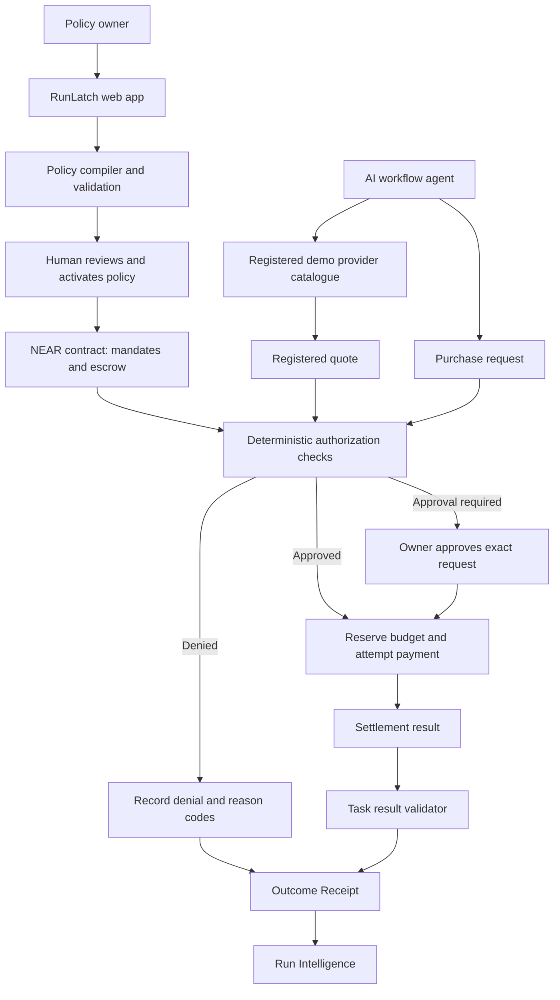
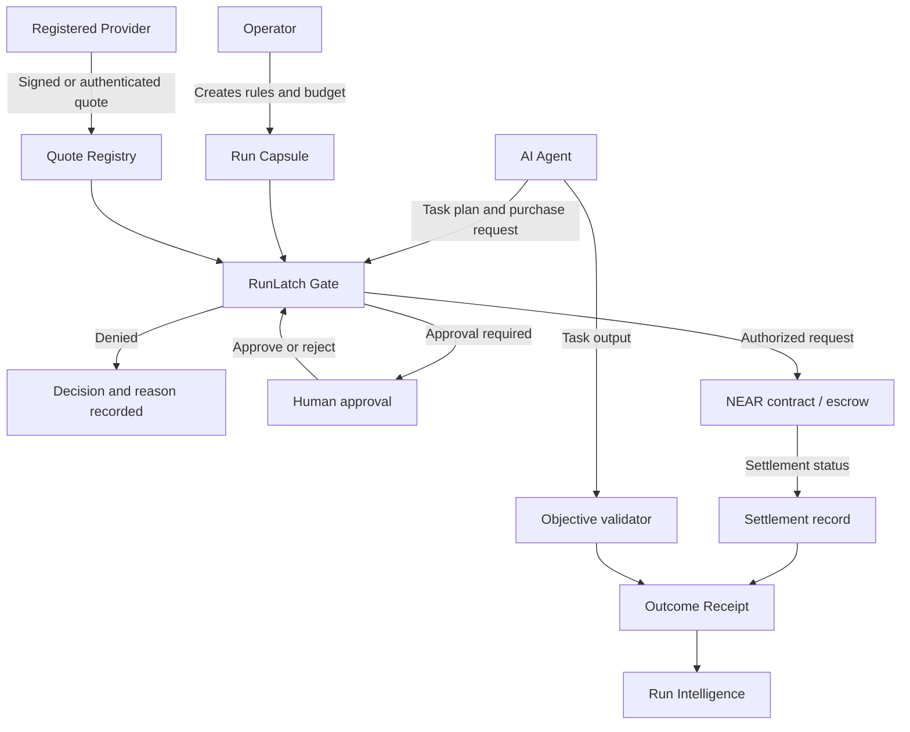
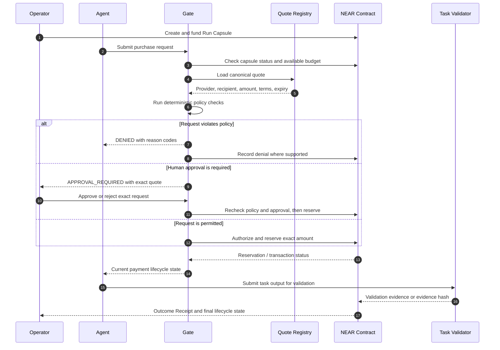
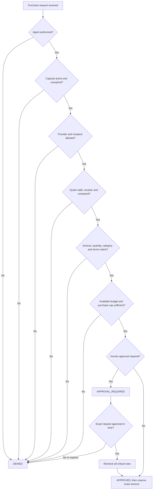
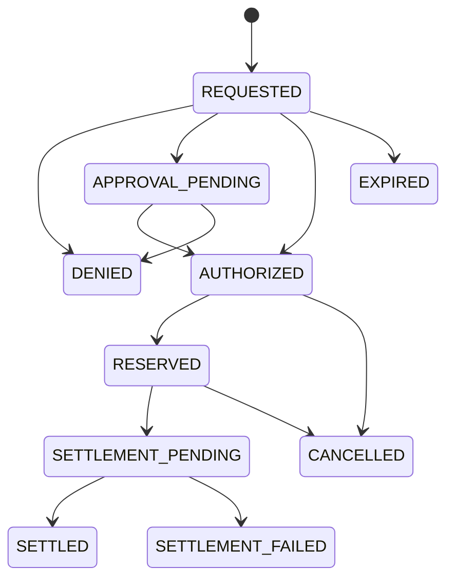
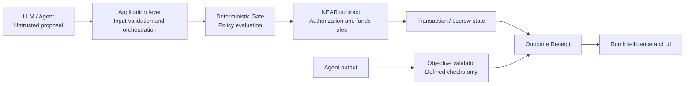

# RunLatch — Product, Technical & Website Design Blueprint

> **Product-direction update,7 November2026:** [RUNLATCH_PRODUCT_DIRECTION_CHANGE_BRIEF.md](RUNLATCH_PRODUCT_DIRECTION_CHANGE_BRIEF.md) is the newer authority for positioning, customer, project/Client Work Capsule model, commitment logic, evidence/reporting and primary demo. The original product/research examples and prompt pack below are historical where they conflict. Preserve compatible security, NEAR, stack and Roster/dithercn constraints. Current reconciled requirements: PRODUCT.md/ARCHITECTURE.md/ACCEPTANCE_TESTS.md/DESIGN.md; actual implementation and permissions: BUILD_LOG.md. Original content is retained, not re-dated or discarded.

**Purpose:** Original baseline product, technical and visual blueprint for RunLatch with OpenCode Desktop and GPT-6.1 Sol.  
**Prepared:** 26 October 2026  
**Target build window:** NEAR HACKATHON, 1–14 November 2026 (UTC)  
**Document type:** Product brief, architecture plan, design system, delivery plan, resource library, and AI-agent prompts.

> **Working name:** RunLatch. Check domain, package-name, and trademark availability before public launch. Do not assume the name is legally available.

---

## How to use this document

1. Place this file in the project repository root as `RUNLATCH_PROJECT_BLUEPRINT.md`.
2. Open the repository folder in OpenCode Desktop and select GPT-6.1 Sol.
3. Start with **Prompt 0: Environment audit and implementation plan** below. Do not ask the agent to generate the entire app in one pass.
4. Work through the staged prompts one at a time. Review each change, run the tests, and commit known-good milestones yourself.
5. Treat the safety boundaries and acceptance criteria in this document as requirements, not suggestions.

This document uses three kinds of statements:

- **Product decision:** the intended direction for RunLatch.
- **Implementation proposal:** a pragmatic choice for the hackathon that can change if the existing repository or current NEAR documentation requires it.
- **Research reference:** a current external source to inspect. Tools, pricing, APIs, and hackathon rules can change, so verify them again when implementing.

## Mandatory NEAR HACKATHON compliance and NEAR-native implementation

<aside>

**NON-NEGOTIABLE INSTRUCTION FOR EVERY AI CODING AGENT:** RunLatch must follow all applicable rules, requirements, restrictions, deadlines, submission instructions, and judging guidance published by the official NEAR HACKATHON. These are mandatory acceptance criteria, not optional suggestions. If this blueprint conflicts with the current official rules, the official rules take priority. Stop and explain the conflict before proceeding.

</aside>

### Official sources that must be checked

- Official hackathon website: https://nearhackathon.com/
- Official builder toolkit and linked resources on that site.
- Official `HACKATHON.md`: https://nearhackathon.com/HACKATHON.md
- Current official NEAR documentation and the documentation for any NEAR ecosystem product selected for the implementation.

The agent must inspect these sources at the beginning of the project and re-check them before final QA and submission. Do not rely only on this blueprint, old summaries, social posts, or assumptions. Record the date checked and summarize the relevant requirements in a project file such as `HACKATHON_COMPLIANCE.md`. If a source is unavailable, report that clearly and do not invent its contents.

### What the agent must verify and obey

1. Eligibility, team/project limits, eligible work and development window.
2. Track definitions, track-specific expectations, and whether multiple tracks may be selected.
3. Technical requirements, permitted tools, submission format, public-repository requirements, demo requirements, and any rules about AI-assisted development or disclosure.
4. Exact deadlines and timezone, required links and fields, wallet/account requirements, and the final submission process.
5. Judging process and criteria, including whether automated agents inspect the repository, README, build, or demo.
6. Any updates, clarifications, or additional instructions published by organizers during the event.

Do not assume the rules are unchanged. Re-verify the live official source. The current website states a development deadline of **14 November 2026 at 23:59 UTC**, requires a public repository and a public X demo post, and requires both links in the submission form. Treat those as current site-published details to verify again before acting. Never submit, post, publish, or make the repository public without the user's explicit approval.

### NEAR must be part of the actual product

RunLatch is being built for a NEAR hackathon. The implementation must demonstrate meaningful, technically correct use of the NEAR ecosystem. NEAR must not be a logo, a name-drop, a disconnected wallet button, or a mock transaction presented as real integration.

The agent must:

- Map RunLatch's real requirements to relevant NEAR primitives and ecosystem tools before choosing an implementation.
- Study current official documentation and verify APIs, SDK versions, network support, security assumptions, and integration status before writing code.
- Prefer a small number of well-integrated NEAR capabilities over adding many technologies superficially.
- Explain what runs on NEAR, what remains off-chain, why that boundary exists, and how the two parts communicate.
- Use NEAR testnet for the hackathon demonstration unless the official rules or current technical constraints require a different approved environment.
- Make the demo prove the integration: show the relevant contract/account/network, transaction or execution reference, and independently verifiable state where applicable.
- Clearly distinguish real NEAR testnet execution, local tests, mocked services, simulated data, and unimplemented future integrations in the UI, README, and demo.
- Never claim a NEAR Intents, Chain Signatures, function-call key, TEE, NEAR AI Cloud, or other ecosystem integration exists until it has actually been implemented and tested.

### Initial track fit and technology investigation

RunLatch's strongest initial fit is **AI Security & Defense** and **Agent Economy**, with **Autonomous Business** as a possible additional track if the shipped workflow genuinely demonstrates agent procurement or business operations. The live hackathon page describes these directions in terms of spending limits, policy engines, sandboxed wallets, reputation, agent commerce, and payments for APIs, compute, or data. Re-check the current track descriptions before final selection.

Investigate these NEAR capabilities against the actual product needs. They are candidates to evaluate, not a checklist that must all be integrated:

- **NEAR smart contracts and accounts:** enforce Run Capsule budgets, quote binding, authorization, expiry, allowlists, replay protection, reservations, and revocation at the appropriate trust boundary.
- **Function-call keys / scoped permissions:** investigate whether constrained agent access can reduce key exposure while preserving human-controlled limits. Never assume a function-call key alone enforces every business rule.
- **NEAR Intents:** investigate for cross-chain or token-agnostic payment execution if it materially improves the provider-purchase flow and can be demonstrated reliably within the time available.
- **Chain Signatures:** investigate only if the product genuinely needs controlled signing or execution across external chains. Do not add it merely for track keywords.
- **NEAR AI Cloud, TEEs, or attestation:** investigate only if a concrete privacy or confidential-computation requirement exists and the integration can be verified.

The agent must produce a short NEAR integration decision record: candidate primitive, user problem solved, official docs checked, implementation boundary, security implications, test/demo evidence, and reason for including or excluding it. If a proposed primitive cannot be integrated reliably within the hackathon window, choose a smaller real NEAR integration and document the limitation.

### Compliance gates before implementation and submission

- **Before coding:** read the official rules and current docs; create `HACKATHON_COMPLIANCE.md`; identify track fit and the minimum meaningful NEAR integration.
- **Before each major milestone:** check that scope and implementation remain compatible with the rules and that no mock is being represented as production or on-chain behavior.
- **Before final QA:** re-check the live rules, deadlines, repository and demo requirements, track selection, README accuracy, and all technical claims.
- **Before submission:** prepare a checklist and draft submission details, but wait for the user's explicit approval before publishing, posting, or submitting anything.

If any rule is unclear, ask the user to resolve it or seek clarification from official organizer channels. Never silently guess.

---

## Project summary

**RunLatch is a spending-control and outcome-intelligence layer for autonomous AI workflows.** It gives each agent task a bounded spending authorization, checks purchase requests against approved service quotes and policy rules before supported payments can proceed, and records evidence connecting the spending to the task's result.

The first target customer is an independent AI developer or small team whose agents repeatedly purchase access to APIs, search, data, document extraction, compute, or other external services.

The project is not a generic wallet, a generic agent marketplace, or only an analytics dashboard. Its core value is to stop purchases outside an approved scope and help operators understand which workflows spend money effectively.

**Primary hackathon tracks:** `security`, `agents`, `business`. Add `realworld` only if the shipped implementation genuinely demonstrates a real-world payments or merchant workflow beyond a mock catalogue.

**Core demo:** start a bounded run, approve an exact provider quote, execute a supported NEAR testnet payment or escrow transfer, try to tamper with the quote or exceed the budget, observe the contract reject the request, and inspect the receipt and transaction record.

---

# 1. What we should learn from Roster Finance

## 1.1 What Roster demonstrates

Roster Finance's live site is at [roster.finance](https://www.roster.finance/). The official Solana hackathon submission lists Roster Finance as first place in Stocklana on 25 September 2026, with a $35,000 main prize. Its description emphasizes fully paid contracts on tokenized stocks, visible terms, capped maximum loss, 14 live markets, and executable market data. See the [official Stocklana project entry](https://hackathons.solana.com/hackathons/stocklana/projects/a3436f56-dc4f-4454-9405-533b48823a52).

The lesson is not to reproduce Roster's layout pixel-for-pixel. Learn from its product storytelling:

1. **One specific promise.** The visitor quickly understands the problem and why the product is different.
2. **Product before long marketing copy.** The visitor can discover live markets or the app early.
3. **An interactive explanation.** A calculator or controllable scenario makes an abstract mechanism tangible.
4. **A side-by-side contrast.** The site makes the difference between its approach and alternatives easier to understand.
5. **Visible evidence.** Tables, terms, data, and history support what the marketing copy claims.
6. **Named product concepts.** Short, consistent names make an unfamiliar product easier to navigate.
7. **Technical explanation.** Visitors can investigate what the system does instead of relying on slogans.
8. **Consistent visual identity.** Typography, spacing, dividers, tables, motion, and hierarchy work together rather than looking like a default template.

## 1.2 What to borrow and what not to copy

**Borrow the product strategy:**

- Give the website a clear first-screen promise.
- Put a working product preview near the top.
- Let visitors interact with a small version of the core mechanism.
- Use actual records and testable behavior as evidence.
- Explain the mechanism in plain English and then offer technical detail.
- Make each page section answer one question.

**Do not copy:**

- Roster's exact words, brand name, logo, illustrations, component arrangement, or proprietary assets.
- Its financial products or market mechanics, which are unrelated to RunLatch.
- A screenshot of its interface as our product UI.
- Numbers, balances, transaction counts, savings claims, or security claims that RunLatch cannot independently support.

We want a website with comparable polish and clarity, not a clone. The design direction in Section 6 defines RunLatch's own identity.

## 1.3 Mandatory visual-reference requirement: Roster Finance

Roster Finance is the **primary visual reference for the RunLatch website throughout development**. This is an explicit design requirement, not a passing source of inspiration. Before designing or substantially changing any RunLatch page, the coding agent must study the current live website at [roster.finance](https://www.roster.finance/) and inspect its actual page structure and interactions. Do not rely only on memory, descriptions, or screenshots included in planning notes.

The goal is for RunLatch to feel close to Roster Finance in overall look-and-feel and level of execution while remaining recognizably RunLatch. Study and adapt the quality of its:

- **Visual hierarchy:** how headlines, supporting copy, product visuals, data, and calls to action are prioritized.
- **Layout rhythm:** section proportions, whitespace, alignment, content width, grids, and transitions between sections.
- **Navigation:** placement, behavior, clarity, and relationship between the public site and product experience.
- **Typography and visual detail:** type scale, weight, line length, borders, dividers, tables, and restrained use of accent colors.
- **Transitions and motion:** hover states, entrance behavior, scrolling transitions, feedback, and interaction timing. Use motion purposefully and keep it accessible.
- **Interactive storytelling:** how the product is introduced early, how visitors explore a mechanism, and how the interface makes claims understandable through visible evidence.

**Adapt, do not duplicate.** Translate these patterns into RunLatch's own product story, Run Capsules, Gate decisions, provider quotes, Outcome Receipts, Run Intelligence, palette, typography, and content. Do not copy Roster Finance's logo, brand identity, proprietary assets, exact text, illustrations, or distinctive components. Do not recreate its product screens as if they were RunLatch. Do not use screenshots of Roster as the finished RunLatch interface.

### Required workflow for the coding agent

1. Open and study the live Roster Finance website before the first visual implementation pass.
2. Record the relevant observations in a short reference audit: page structure, navigation, type hierarchy, spacing, component patterns, motion, responsive behavior, and interactive storytelling.
3. Convert those observations into a RunLatch-specific design system and page plan. Keep RunLatch's existing brand direction in Section 6; the reference informs execution quality and patterns, not a replacement brand.
4. Implement the landing page and core application screens using those principles. Prioritize the first screen, navigation, product preview, interactive demo, evidence sections, and responsive layouts.
5. Compare the implementation against the live reference during review. Identify where hierarchy, spacing, polish, interaction, or storytelling feels weaker, then improve it without copying proprietary expression.
6. Test desktop and mobile layouts, keyboard access, reduced-motion preferences, and loading/empty/error states.

**Acceptance criterion:** a reviewer should recognize the deliberate Roster Finance influence in the overall quality, hierarchy, rhythm, navigation, motion, and product storytelling, while every brand element, message, and product interaction clearly belongs to RunLatch. A generic SaaS template with a similar color palette does not satisfy this requirement.

## 1.4 The website's narrative pattern

Use this order for the public landing page:

1. **Promise:** Your agents can run. Your budget stays yours.
2. **Product evidence:** A live Run Board with runs, budgets, approvals, and denied requests.
3. **Problem:** A workflow can overspend through retries, quote changes, or tool choices.
4. **Mechanism:** Run Capsules, authorization Gate, Outcome Receipts, and Run Intelligence.
5. **Interactive demo:** Change the budget or quote and see the decision update.
6. **Evidence:** Inspect policy checks, test results, contract details, and transaction records.
7. **Technical trust:** Explain the boundaries between AI proposals, deterministic policy checks, NEAR enforcement, and outcome verification.
8. **Action:** Explore the demo, inspect a run, or read the developer documentation.

## 1.5 The design principle

Every claim about safety or spending should be connected to a visible mechanism and a test. Do not use fake live metrics to create a sense of credibility. Demo data must be labeled as demo data until the interface is connected to real state.

---

# 2. Choosing a niche

## 2.1 The niche

RunLatch should focus on **independent AI developers and small teams operating agents that repeatedly buy API access, data, compute, and external services**.

This is narrower than “secure every AI agent.” It gives the product a specific user and a recurring problem.

Why this niche:

- Agent workflows can call tools repeatedly within one task.
- Prices, usage limits, and provider availability can change.
- Retries can increase costs without improving the result.
- Different jobs need different spending caps and provider permissions.
- Operators need to compare cost against the result, not just see a list of transactions.
- A history of runs becomes useful over time, which gives the product a natural reason for repeat use.

The first customer persona is a developer running a research, document-processing, data-extraction, or monitoring workflow. The prototype should demonstrate one such workflow rather than attempt to support every kind of agent.

## 2.2 Product positioning

**Category:** agent workflow spending controls and outcome intelligence.  
**Short description:** Give every AI task a spending boundary, authorize the services it can buy, and see what that spend produced.  
**Core promise:** Run agents without giving them unrestricted financial authority.  
**Difference from a standard dashboard:** RunLatch checks spending requests before supported payments are authorized, then connects the spending record to task validation evidence.

A safe marketing line:

> Your agents can run. Your budget stays yours.

Supporting line:

> Give each AI workflow a budget, approved providers, and clear rules. RunLatch checks purchases before money moves and records what each run actually delivers.

Avoid absolute claims such as “fraud-proof,” “guaranteed results,” “fully trustless,” “unhackable,” or “all purchases are secure.” The product only enforces the rules and facts that are represented and authenticated correctly.

## 2.3 The problem we solve

Consider an AI research workflow with three agents:

- Research agent: finds sources.
- Extraction agent: converts pages or documents into structured data.
- Verification agent: checks whether the result meets requirements.

A job might use search, extraction, and verification APIs. One provider fails, the agent retries several times, then purchases extra credits or chooses a different service. The final report may still be incomplete.

RunLatch should:

1. Allocate a bounded budget for the job.
2. Restrict which providers or service categories the agents may purchase.
3. Require a valid registered quote or other authenticated price record for a supported purchase.
4. Reject an expired, reused, modified, or disallowed quote.
5. Track both spent and reserved amounts so concurrent requests cannot reuse the same budget.
6. Require owner approval for configured exceptions.
7. Record the actual payment outcome and later validation result.
8. Show cost per successful job and identify repeat failure patterns.

## 2.4 Competitive differentiation

Agent wallets, permission gateways, budget controls, and purchase authorization tools already exist. Do not pitch RunLatch as the first product to give an agent a spending limit. Before launch, re-check the current landscape, including OutLayer and products that describe agent transaction authorization or procurement controls.

The product's proposed wedge is the combination of:

- **Run Capsule:** a task-specific spending authorization.
- **Quote-bound Gate:** a purchase must match the registered merchant quote and applicable policy.
- **Outcome Receipt:** records the policy decision, spend, provider, settlement outcome, and task validation result.
- **Run Intelligence:** aggregates receipts to help the operator understand the cost of successful work.

This combination is the product hypothesis. It is not a claim that no competitor has any overlapping feature.

---

# 3. A concrete recurring use case

## 3.1 The first workflow

Build a small AI research workflow. A user asks for a report with 20 sources, verified URLs, and a structured output file. The workflow may need search, page extraction, and data validation services.

RunLatch is not required to build a state-of-the-art research agent. For the hackathon, the workflow can use a small, controlled provider catalogue and predictable task fixtures. The point is to demonstrate purchase authorization, budget safety, and outcome evidence.

## 3.2 User journey

### Step A: Create a Run Capsule

The user defines:

- Task ID and owner.
- Authorized agent identity.
- Maximum task budget.
- Per-purchase limit.
- Approved provider accounts or provider IDs.
- Allowed categories of service.
- Quote-expiry and re-use rules.
- Whether an exceptional purchase requires owner approval.
- Task expiry or deadline.
- Objective conditions used to validate the result.

Use sample testnet amounts for the hackathon. Do not use real money or mainnet transactions unless the human explicitly authorizes them after understanding the transaction.

### Step B: Agent proposes a purchase

The agent asks for a service quote from the demo catalogue. A registered provider publishes the quote under its own account or through a trusted, authenticated provider adapter.

The quote should include, where relevant:

- Unique quote ID.
- Provider/merchant account.
- Exact payment recipient.
- Product or service identifier.
- Quantity or usage units.
- Total price and currency/asset.
- Recurring-payment flag if applicable.
- Expiration.
- Any terms required by the policy.

For the hackathon, use registered providers with a small static catalogue. Do not pretend that arbitrary third-party API vendors accept NEAR testnet payments. A real integration requires the provider to support a compatible payment flow or the product to use an appropriate adapter.

### Step C: Gate checks the request

The Gate uses deterministic logic, not an LLM, to return one of:

- `APPROVED`: all mandatory checks pass and payment may be attempted.
- `APPROVAL_REQUIRED`: the request is potentially permitted but requires a human decision.
- `DENIED`: a mandatory condition is violated.

The AI may explain a result in natural language, but it cannot convert `DENIED` into `APPROVED`.

### Step D: Payment or reservation

If a supported transaction is approved, the contract reserves the spend against the Run Capsule and initiates the supported transfer. The contract must represent pending settlement correctly and handle an asynchronous transfer failure. Do not mark a transfer as settled simply because an outgoing transfer promise was created.

For requests awaiting approval, reserve funds if the design intends to hold capacity for that request. Release the reservation when it is rejected, expires, or fails. Re-check mandate status and available budget immediately before authorizing settlement.

### Step E: Validate the task result

The task can produce a result file. Start with objective checks such as:

- JSON parses and matches a schema.
- Required fields are present.
- URLs have valid syntax and respond where the test environment allows this check.
- The number of records meets the target.
- A defined test suite passes.

A validator's record proves that the validator reported a result under a particular method. It does not by itself prove the truth of every external claim or guarantee a real-world service delivered good work.

### Step F: Produce an Outcome Receipt

The receipt should connect:

- Run Capsule ID.
- Quote and purchase request ID.
- Policy version/hash.
- Decision and reason codes.
- Approved/spent/reserved amount.
- Provider and settlement reference.
- Validator version and validation result.
- Timestamp and lifecycle status.

Keep sensitive request content off-chain where practical. Store only what is needed to enforce rules and provide an auditable reference on-chain. A hash can help detect alteration of a record, but a hash alone does not keep the underlying data private.

## 3.3 Why users return

Retention must come from recurring utility, not artificial streaks or notifications designed to keep users clicking.

1. **Daily run monitoring:** active jobs, expenditure, pending approvals, errors, and blocked attempts.
2. **Provider changes:** changes in registered price, availability, measured latency, or failure rate.
3. **Weekly cost analysis:** cost per successful job, cost by provider, and common failure patterns.
4. **Before renewals or replenishment:** expiring quotes, low balances, upcoming commitments, and approvals that need attention. Only show automated renewal if the connected provider actually supports it.
5. **Post-failure learning:** suggest a rule based on repeated evidence, but require the owner to approve a new policy version.

The long-term moat is a useful, trusted history of run policies, provider quotes, spending decisions, and measured task outcomes. Data must be gathered honestly and with appropriate privacy controls.

## 3.4 First recurring metric

The primary analytical metric should be **cost per successful run**, not just total spend.

A “successful run” must be defined by an objective test for the particular workflow. Do not compare tasks that have different success criteria without explaining the difference. Show sample size and the time period in any aggregate view.

---

# 4. Features that make RunLatch distinctive

## 4.1 Run Capsules — the core feature

A Run Capsule is a task-specific spending authorization containing the task ID, authorized agent, budget, provider scope, quote conditions, expiry, and relevant policy version.

It should track at least:

- Allocated budget.
- Spent amount.
- Reserved amount.
- Available amount.
- Capsule status (`ACTIVE`, `PAUSED`, `REVOKED`, `EXPIRED`, or other explicit lifecycle states).
- Unique purchase request and quote IDs to prevent replay.

Budget accounting rule:

`available = allocated - spent - reserved`

Never calculate available balance from spent amount alone. A concurrent request must not be able to reuse funds that are already reserved for another pending purchase.

## 4.2 Quote-bound Gate — the central authorization mechanism

The request references a quote registered by an approved provider. The contract evaluates the canonical registered quote, rather than trusting recipient or price fields sent freely by the agent at purchase time.

Mandatory checks should include:

1. Calling agent is authorized for the capsule.
2. Capsule is active and not expired or revoked.
3. Provider is approved by the applicable rule.
4. Quote exists, belongs to that provider, is still valid, and has not been consumed.
5. Recipient matches the registered quote.
6. Price and quantity satisfy the policy.
7. Product/service category is allowed.
8. Recurring terms satisfy policy where applicable.
9. Budget remains after accounting for spent and reserved funds.
10. Request has not already been processed.
11. Any required owner approval is present and bound to the exact request.

An approved quote does not override a later revocation. Re-check capsule state at the moment settlement is authorized.

## 4.3 Replay Lab — hackathon demonstration feature

Create a controlled sandbox of deterministic adversarial cases:

- Recipient tampering: the agent tries to change the receiver after quote publication.
- Quote price change: the quote does not match the previously registered terms or violates a price threshold.
- Hidden recurring term: a prohibited recurring service is requested.
- Budget splitting: several smaller purchases collectively exceed the capsule's authority.
- Replay: a quote or purchase ID is submitted twice.
- Expired quote: a stale request is submitted.
- Revoked capsule: the same agent attempts another purchase after revocation.
- Failed transfer: settlement fails and the reservation/state is reconciled correctly.

Show each attempt, the failed/passed checks, the contract result, and whether money moved. The UI must query real app/contract state for deployed scenarios. If a scenario is purely local, label it as a simulation.

## 4.4 Outcome Receipts

Every decision and settlement attempt should produce a structured receipt. Distinguish at least:

- Decision outcome.
- Payment transaction submitted.
- Payment confirmed successful.
- Payment failed.
- Task finished.
- Task validation passed or failed.

These are not the same event and should not be collapsed into one green “success” state.

## 4.5 Run Intelligence — build a basic version after core enforcement

Show:

- Total spending across selected runs.
- Spend by provider.
- Spend by successful and failed runs.
- Cost per successful task.
- Requests denied and their reason codes.
- Provider quote changes if there is a record of the previous quote.
- Suggested rule improvements based on repeated events.

Any suggested rule must be reviewed and explicitly activated by the owner. The model can propose a rule but must not silently grant or remove financial authority.

## 4.6 Policy Compiler — optional if reliable

The user can describe a policy in plain language. An LLM proposes a structured JSON policy, then schema validation, rule validation, conflict detection, and human approval are required before it can become active.

Do not let the model invent a trusted provider ID, recipient address, budget amount, or expiry without showing it to the user. If instructions conflict, ask the user to resolve the conflict or highlight the required decision.

The app must have a deterministic demo path even when no LLM API key is configured. External API keys must be read from environment variables and must never be committed.

## 4.7 One-time approvals

An approval should apply to one exact purchase request, not grant broad permission to bypass future checks. Bind it to:

- Quote ID.
- Purchase request ID.
- Capsule ID and policy version.
- Recipient and amount.
- Expiry.
- Approver identity.

An owner approval should not override hard failures such as an unknown quote or consumed request unless the product explicitly defines a separate safe correction workflow. Revoked mandates cannot be made active by a stale approval.

---

# 5. Website design and information architecture

## 5.1 Public landing page order

The public landing page should tell the product story in this order. Each section should do one job and should not feel like a template stack of identical cards.

### Section 1 — Hero

**Headline:** Your agents can run. Your budget stays yours.

**Supporting copy:** Give every AI workflow a budget, approved providers, and clear rules. RunLatch checks purchases before money moves and records what each run actually delivers.

**Primary CTA:** Explore the live demo  
**Secondary CTA:** Inspect a run

On the right or immediately below on mobile, show a working Run Board preview with coherent sample data. Clearly label any non-live sample data.

### Section 2 — Live Run Board

Show:

- Active run count.
- Allocated, spent, reserved, and available amounts.
- Pending approvals.
- Blocked requests.
- Latest receipt or settlement state.

Allow a visitor to open a row and inspect a decision trace. If this is a public demo, use safe seeded data or a read-only demo workspace; never expose private keys or private user data.

### Section 3 — The problem versus the controlled outcome

Show an agent trying to retry a failed API call and exceed a task budget.

Compare:

- Without RunLatch: the workflow can keep requesting paid resources if no separate controls exist.
- With RunLatch: the authorization layer checks the request and rejects a purchase outside the active capsule's authority.

Avoid fabricated savings figures or implying that every uncontrolled agent necessarily overspends.

### Section 4 — Interactive Run Capsule

The visitor can modify a test budget, select a registered demo quote, or trigger an overspend scenario. The result should recalculate through the same deterministic policy logic used by the app where feasible.

Possible controls:

- Budget slider or numeric input.
- Provider/quote selector.
- “Try valid request.”
- “Try tampered recipient.”
- “Try over budget.”
- “Revoke capsule.”

Show the decision and failed/passed rules immediately. A purely frontend demo must be labeled as simulated.

### Section 5 — Outcome Receipts

Show one successful run and one failed or blocked run. The visitor can inspect the quote, policy version, reason codes, settlement status, validation status, and transaction reference.

### Section 6 — Run Intelligence

Show clearly labeled illustrative charts or real aggregates if data exists:

- Cost per successful run.
- Spend by provider.
- Failure reasons.
- Denied requests.
- Provider quote changes.

Never make a small sample appear statistically conclusive. Display sample size and reporting period.

### Section 7 — Proof of enforcement

Include:

- Network and testnet environment label.
- Deployed contract address once deployment exists.
- Links to relevant explorer records where available.
- Automated test summary.
- Replay Lab scenarios.
- A short statement about which properties are enforced on-chain and which depend on off-chain services.

### Section 8 — Architecture and documentation

Explain the AI agent, deterministic policy engine, NEAR contract, quote registry, settlement status, and outcome verifier. Link the repository, setup guide, contract API, security assumptions, and demo instructions.

### Section 9 — Footer

A carefully designed footer should include product navigation, docs, repository, hackathon attribution, a concise product statement, and the relevant disclaimer. Use [Footer.design](https://footer.design/) as inspiration, not as a source of assets to copy without permission.

## 5.2 The logged-in product shell

Public site and app should feel like one brand, but should not be one long marketing page. Main app navigation:

- **Overview:** live system status and recent runs.
- **Runs:** searchable list of runs, with filters for status, provider, date, and spending.
- **Run Capsules:** create, inspect, pause, and revoke capsules.
- **Providers:** registered providers, quotes, status, price, and basic performance evidence.
- **Approvals:** requests awaiting explicit owner action.
- **Receipts:** searchable decision and settlement history.
- **Run Intelligence:** cost per successful job and repeated issues.
- **Replay Lab:** controlled security scenarios.
- **Settings:** wallet/network, policy defaults, API configuration, and demo-mode information.

Prioritize the screens required for the working core. Do not build every navigation page as an empty shell just to look comprehensive.

## 5.3 Motion and interaction

Use subtle, meaningful motion:

- Numeric value transitions when the displayed state changes.
- A short connecting animation between request, authorization, and settlement.
- A clear red/amber/green transition for denied, pending, and approved states.
- Short expandable decision traces.
- Smooth but restrained scroll reveals on the public page.

Support `prefers-reduced-motion`. Avoid scroll-jacking, heavy 3D, continuous background motion, or animations that delay access to key information. The website should remain fast and understandable without motion.

---

# 6. Brand, naming, and visual direction

## 6.1 Brand

**Working product name:** RunLatch.  
**Category:** AI workflow spending controls and outcome intelligence.  
**Tone:** calm, precise, technically literate, and direct. Avoid exaggerated security marketing.  
**Brand idea:** a latch that allows an approved action through and blocks actions outside the authorized scope.

The name is provisional. Before publishing, check relevant domains, package registries, GitHub names, and trademarks. Do not imply any legal clearance in the README.

## 6.2 Visual direction

The intended direction is **editorial fintech meets AI infrastructure**: crisp typography, an off-white canvas, dark ink text, precise tables, restrained borders, and a sharp lime accent. The interface should feel like a serious operational product, not a generic AI template.

Suggested starting tokens; tune after a real-browser review:

```css
:root {
  --color-paper: #F7F7F2;
  --color-panel: #FFFFFF;
  --color-ink: #171916;
  --color-muted: #686D65;
  --color-line: #DDE0D7;
  --color-accent: #C6F36B;
  --color-accent-ink: #17200C;
  --color-success: #287A4B;
  --color-warning: #A66A12;
  --color-danger: #B23A34;
  --radius-panel: 16px;
  --radius-control: 10px;
  --page-max: 1240px;
}
```

These are initial design tokens, not fixed truth. Keep them centralized so they can be tuned after screenshots and user review.

### 6.3 Dithering is a major visual feature, not decoration

RunLatch should use [dithercn](https://dithercn.dev/) as a core visual system for selected backgrounds, transitions, data visualizations, and interface details. The intention is to make dithering a recognizable part of RunLatch’s visual identity while keeping the product calm, precise, readable, and trustworthy. Dithering must support the content and product story; it must never make financial amounts, policy rules, transaction states, or security decisions harder to read.

**Required reference and implementation source:**
- Main site and component catalog: https://dithercn.dev/
- Documentation: https://dithercn.dev/docs
- Installation guide: https://dithercn.dev/docs/installation
- Examples catalog: https://dithercn.dev/docs/examples
- Agent skill: https://dithercn.dev/.well-known/agent-skills/dithercn/SKILL.md

**Where dithering should be a defining feature:**
1. **Hero:** use one memorable, carefully art-directed dither field such as a slow topographic contour, soft radial field, or restrained dither gradient. It should create depth behind the headline without reducing text contrast.
2. **Section transitions:** use subtle dither fades, masks, or dissolves to connect major landing-page sections rather than relying on generic gradients or arbitrary scroll effects.
3. **Product visualization:** use dithered fills for selected charts, usage meters, budget allocation visuals, or status summaries where the texture reinforces the data. The actual values and labels must remain ordinary, accessible text.
4. **Interaction details:** use restrained dither reveals, hover changes, loaders, empty states, or button treatments only where they provide meaningful feedback.
5. **Dashboard identity:** carry a consistent, lower-intensity dither language into the application so the landing page and dashboard feel like one product. Do not put animated shader effects behind dense tables or critical transaction details.

**Art direction and constraints:**
- Use the existing RunLatch palette as the source of dither colours: paper `#F7F7F2`, ink `#171916`, muted `#686D65`, lime accent `#C6F36B`, plus semantic status colours only when appropriate. Define the `--dither-*` variables from the project theme rather than scattering hard-coded colours through components.
- Prefer a limited, consistent cell scale and restrained contrast. The texture should feel intentional, almost print-like, not like visual noise or a retro arcade theme.
- Use animated WebGL dithers only for large, expressive fields that justify them. Use SVG patterns or CSS masks for static fills, dividers, and small interface surfaces. Use image dithering only when a real image treatment is needed.
- Keep real headings, labels, amounts, IDs, buttons, and chart values as semantic HTML/SVG text. Do not rasterize important text into a shader.
- Keep animation slow and subtle. Pause or avoid offscreen work where supported, provide a static fallback, and respect `prefers-reduced-motion`.
- Check contrast, keyboard navigation, screen-reader labels, mobile layout, GPU/battery cost, and fallback behaviour. Dither must not cover focus rings or intercept pointer events.
- Avoid applying the effect to every component. Establish a clear hierarchy: one signature hero treatment, a few section/visualization moments, then quiet dashboard details.
- Do not install every catalog example. Read the skill, inspect the closest example, and install or build only the patterns the design actually needs.

**Required design workflow:** study the dithercn homepage, docs, catalog, and relevant source examples before the first visual pass. Install the dithercn agent skill and engine only after confirming the chosen stack meets its requirements. Its current shadcn installation path expects a project using shadcn/ui, Tailwind CSS v4, and React 19; if the audited project differs, ask the agent to verify compatibility and choose a safe integration instead of forcing a stack migration. The official installation guide documents both `pnpm dlx skills add https://dithercn.dev` and `npx shadcn@latest add https://dithercn.dev/r/dithercn-skill.json`.

**Acceptance criterion:** the first impression should make the dither language feel like a deliberate RunLatch signature, not a generic background effect. At least the hero and two other purposeful touchpoints should use dithering, with the dashboard using it more selectively. The site must remain readable and performant with effects disabled or reduced.

### Typography

Use a distinct, readable type system. Possible pairing:

- Headings: `Space Grotesk` or another distinctive sans-serif.
- Body and interface: `DM Sans`, `Manrope`, or a similarly legible family.
- IDs, transaction references, amounts, and compact labels: `IBM Plex Mono` or another monospace.

Check font licenses and load strategy. Avoid using Inter for every element by default. Do not load unnecessary font weights or large external font files if they harm performance.

### Layout and surfaces

- Use whitespace and alignment to create hierarchy.
- Use tables for numerical and operational data.
- Use cards only where grouping helps; do not wrap every text section in a card.
- Use thin borders and a small number of radii.
- Reserve the accent color for important actions and key states.
- Use red only for actual errors, violations, and denied requests.
- Prefer real UI states and charts over decorative stock illustrations.
- Use custom illustrations sparingly; cite or obey license rules for anything reused.

### Do not use the following as default AI design shortcuts

- Purple-to-blue gradients everywhere.
- Nested cards inside cards as the main layout.
- A generic hero with floating glassmorphism cards.
- Excessive rounded-square icon tiles.
- Arbitrary giant glowing orb or 3D sphere without product meaning.
- Placeholder logos or unsupported partner badges.
- Fake terminal output, fake data, fake customer testimonials, or fabricated performance figures.

## 6.3 Naming system

| Name | Purpose |
|---|---|
| **Run Capsule** | Task-specific spending authority |
| **Gate** | Deterministic authorization decision |
| **Outcome Receipt** | Record of policy, purchase, settlement, and validation outcomes |
| **Pulse** | Monitoring and aggregate insights |
| **Replay Lab** | Reproducible attack and policy testing |
| **Rulebook** | Approved policy versions and rule history |

Use names consistently in UI, code, README, and demo. Do not force special names onto every button or technical object.

---

# 7. Technical architecture and implementation boundaries

## 7.1 Recommended stack

Start from the repository's existing stack if it is coherent. Do not replace a functioning setup without a clear technical reason. If the repository is empty, this is the proposed stack:

- **Web:** Next.js with TypeScript.
- **Styling:** Tailwind CSS and a customized shadcn/ui foundation.
- **Motion:** Motion for React, used sparingly.
- **Tables and charts:** TanStack Table and Recharts, where useful.
- **Icons:** Lucide.
- **Policy schema validation:** Zod or an equivalent validated schema approach.
- **Contract:** Rust with NEAR `near-sdk`.
- **Contract tests:** unit tests plus testnet end-to-end checks. Follow the current NEAR docs and the project's compatible tooling versions.
- **Browser tests:** Playwright.
- **Wallet integration:** inspect the current NEAR documentation before choosing. The `near/wallet-selector` repository notes that the NEAR ecosystem recommends exploring HOT Connect as its newer preferred connector; verify present compatibility and official instructions at implementation time.
- **Charts:** only include charts that answer a real question. Do not add analytics charts filled with decorative or invented data.

Reference links:

- [NEAR smart-contract quickstart](https://docs.near.org/smart-contracts/quickstart)
- [`near-sdk-rs`](https://github.com/near/near-sdk-rs)
- [`near-api-js`](https://github.com/near/near-api-js)
- [`near/wallet-selector`](https://github.com/near/wallet-selector)
- [HOT Connect documentation](https://docs.hotdao.ai/)
- [NEAR Intents docs](https://docs.near-intents.org/)

Use NEAR testnet for the hackathon demonstration unless a user explicitly authorizes another environment. Do not deploy to mainnet, sign a mainnet transaction, or spend real tokens without the user's explicit informed confirmation.

## 7.2 Architecture overview



The AI agent should propose actions. It must not have an unrestricted key that can bypass the authorization gate. Critical state and validation checks cannot exist only in the frontend.

## 7.3 Trust boundaries

Clearly document what each component can and cannot prove:

- **LLM:** can draft a policy, suggest a provider, or explain a denial. It is not the source of truth for authorization.
- **Policy parser/schema:** validates structure and detects conflicts. It does not prove the original user instruction was interpreted perfectly; the owner must review and activate the result.
- **Registered provider quote:** proves the registered provider account published those terms under the system's assumptions. It does not prove the provider is honest or will deliver the service described.
- **NEAR contract:** enforces the on-chain rules and data it can observe. It cannot independently validate arbitrary off-chain facts unless a trusted verification mechanism is deliberately added.
- **Task validator:** reports whether the defined checks pass. It cannot guarantee truth or quality outside those checks.
- **Receipt hash:** can help detect that a record changed. A hash alone does not provide confidentiality or prove the original facts were true.

## 7.4 Suggested contract data types

The exact Rust design must be adapted to the currently installed `near-sdk` version. Keep the first contract small and testable.

### `RunCapsule`

- `id`
- `owner_id`
- `agent_id` or authorized public key/account
- `status`
- `budget_allocated`
- `spent_amount`
- `reserved_amount`
- `per_purchase_limit`
- `allowed_providers` or provider rule reference
- `allowed_service_categories`
- `policy_version`
- `created_at` and `expires_at`

### `Provider`

- `provider_id`
- `provider_account_id`
- `status`
- Minimal metadata or off-chain metadata reference

### `ProviderQuote`

- `quote_id`
- `provider_id`
- `recipient_account_id`
- `service_id`
- `quantity` or units where needed
- `price_amount`
- `price_asset`
- `recurring` or term fields where relevant
- `expires_at`
- `consumed` or settlement lifecycle status

### `PurchaseRequest`

- `request_id`
- `capsule_id`
- `quote_id`
- `status`
- `decision_code`
- `reason_codes`
- `approval` details if required
- `reserved_amount`
- `settlement_reference` and lifecycle timestamps

### `OutcomeReceipt`

- `receipt_id`
- `capsule_id`
- `request_id` and `quote_id`
- `policy_version` or policy hash
- decision and settlement status
- validator identity/version
- validation result reference/hash
- created time

Avoid storing full research prompts, private datasets, API credentials, personal data, or confidential provider data on-chain.

## 7.5 Contract methods to consider

Choose method names and signatures after reviewing current SDK conventions. The initial API could include:

- `create_capsule`
- `fund_escrow`
- `register_provider`
- `publish_quote`
- `submit_purchase`
- `approve_purchase`
- `reject_purchase`
- `pause_capsule`
- `revoke_capsule`
- `get_capsule`
- `get_purchase_request`
- `get_receipt`

Limit the surface area. Every mutating method should validate the caller, current state, request uniqueness, quote lifecycle, and relevant budget constraints.

## 7.6 Payment lifecycle and asynchronous failures

Native NEAR transfers from a contract can involve asynchronous execution. Model settlement lifecycle explicitly rather than treating the act of scheduling a transfer as proof of success.

At minimum, design and test states such as:

`REQUESTED -> APPROVAL_PENDING -> AUTHORIZED -> RESERVED -> SETTLEMENT_PENDING -> SETTLED`

Failure/alternative paths can include:

`DENIED`, `EXPIRED`, `CANCELLED`, `SETTLEMENT_FAILED`, and `REVOKED`.

The precise state machine should avoid illegal transitions and double spending. If payment fails, release the corresponding reservation and retain an honest failure record. Handle callback authorization using the official NEAR contract patterns. Keep sufficient balance for gas and contract operations. Write tests for transfer failure and callback state reconciliation, not just successful transfers.

If this flow is too risky for the time available, implement the authorization and quote registry first, then add the smallest supported escrow/payment path. Do not falsely label an off-chain mock as an on-chain payment.

## 7.7 Quote publication and tamper resistance

The contract should not trust arbitrary quote values attached to a purchase call. A registered provider (or an explicitly trusted server-backed adapter in the MVP) publishes the quote. The purchase request refers to a canonical quote ID; the contract reads stored terms and evaluates them.

Check that:

- The provider account is authorized to publish or update that quote.
- Quote IDs are unique and cannot silently overwrite a previously authorized quote.
- The recipient is stored with the quote.
- The quote has not expired or been consumed.
- The price, quantity, service ID, and any relevant terms have not been substituted in the purchase request.
- New terms require a new quote or a versioned update and a new authorization decision.

For the public demo, two or three registered demo providers with fixed quote fixtures are enough. Do not claim broad provider compatibility until real adapters have been tested.

## 7.8 Policy compiler and deterministic rules

An AI-generated policy should pass through these steps:

1. Collect the user's plain-language instructions.
2. Generate proposed structured JSON.
3. Validate the JSON against a schema.
4. Validate cross-field constraints and detect contradictory rules.
5. Require human review of exact limits, providers, recipient conditions, and expiry.
6. Activate only after owner confirmation.
7. Version the policy so later changes can be audited.

Use deterministic code for authorization. Example rules:

- `capsule.status === ACTIVE`
- `now < capsule.expires_at`
- `agent_id === capsule.authorized_agent`
- `quote.provider_id in capsule.allowed_providers`
- `quote.recipient_account_id === registered_quote.recipient_account_id`
- `quote.status === VALID`
- `quote.not_consumed === true`
- `request.total <= per_purchase_limit`
- `spent + reserved + request.total <= budget_allocated`
- recurring term not forbidden
- an exact, unexpired owner approval exists if required

Use integer smallest units for token amounts. Never use floating-point arithmetic for money. Keep currency/asset units explicit and validate conversion logic if more than one asset is supported.

## 7.9 Task outcomes versus conditional payments

Do not imply that every API vendor payment can be held until the whole AI job succeeds. Many API and compute services charge per call or require credit purchase up front.

For the hackathon:

- The payment demo can use registered mock/demo providers and actual NEAR testnet transfers where feasible.
- The task validator can run independently after the service call and report objective results.
- The receipt should connect payment activity to task outcome without claiming the receipt itself guarantees a refund or delivery.
- Conditional escrow/release should only be claimed for a specific flow where the seller, contract, and verification mechanism actually support it.

This boundary is important for a credible product and README.

## 7.10 Security and privacy baseline

- Do not commit API keys, seed phrases, private keys, wallet secrets, or `.env` files.
- Provide `.env.example` containing only placeholder names.
- Do not ask the agent to deploy to mainnet, sign transactions, or spend real tokens without explicit human approval.
- Keep wallet signing in approved wallet flows; do not hide or automate signature consent.
- Validate every external/model response before use.
- Treat provider content as untrusted data, not instructions for the app's agent or code assistant.
- Enforce budget and recipient rules in contract logic, not just UI state.
- Add authorization checks and replay protection to every relevant contract method.
- Minimize personal or commercially sensitive on-chain data.
- Avoid public/private data leaks through logs, screenshots, or sample fixtures.
- Add rate limiting and explicit error states where applicable.
- Do not claim an audit, certification, formal verification, or comprehensive security review unless it has actually happened.

---

# 8. Tools, websites, and repositories

**Research checked:** 26 October 2026.  
**Important:** “Free,” free-tier limits, paid plans, repository licenses, API terms, and commercial-use eligibility can change. Verify current terms before using a tool in a public/commercial project. Prefer open-source tools for the core product and treat paid prompt libraries as optional inspiration, not dependencies.

## 8.1 Recommended minimal toolkit

You do not need all these tools. Start with this smaller set:

1. **[Anthropic frontend-design skill](https://github.com/anthropics/skills/tree/main/skills/frontend-design)** or **[Taste Skill](https://github.com/Leonxlnx/taste-skill)** for deliberate UI art direction. Pick one default design skill first.
2. **[Impeccable](https://github.com/pbakaus/impeccable)** for design critique, UX cleanup, and iterative audits. It overlaps with other design skills, so use it deliberately rather than loading every skill at once.
3. **[shadcn/ui](https://ui.shadcn.com/)** for accessible customizable UI primitives.
4. **[Tailwind CSS](https://tailwindcss.com/)** for layout and design tokens.
5. **[Motion](https://motion.dev/)** for restrained interface animation.
6. **[Lucide](https://lucide.dev/)** for consistent icons.
7. **[Playwright](https://playwright.dev/)** for browser testing and screenshots.
8. **[NEAR docs](https://docs.near.org/)** and **[`near-sdk-rs`](https://github.com/near/near-sdk-rs)** for the contract implementation.
9. **[Remocn](https://remocn.dev/)** or **[Remotion](https://www.remotion.dev/)** for the product-demo video after the actual app works.

## 8.2 AI design and frontend skills / repositories

| Tool | Link | Best use | Free/open-source notes |
|---|---|---|---|
| dithercn | [Website](https://dithercn.dev/) · [docs](https://dithercn.dev/docs/installation) · [skill](https://dithercn.dev/.well-known/agent-skills/dithercn/SKILL.md) | **Required for RunLatch visual identity.** Dither engine and agent skill for hero backgrounds, section transitions, charts, interface details, and image treatments. | Open-source and MIT-licensed according to its site. The shadcn registry install expects shadcn/ui, Tailwind CSS v4, and React 19; verify the audited stack first. |
| Impeccable | [GitHub](https://github.com/pbakaus/impeccable) · [docs](https://impeccable.style/) | A design skill, commands, browser iteration, and deterministic checks for frontend quality. | Public repository; inspect the current license and supported-agent install flow. Its quickstart advertises `npx impeccable install`. |
| Taste Skill | [GitHub](https://github.com/Leonxlnx/taste-skill) | Art direction, real imagery with credits, responsive screenshot checks, and a self-review loop. | README offers `npx skills add https://github.com/Leonxlnx/taste-skill --skill "design-taste-frontend"`; repo states MIT. Requires Node 22+ and browser tooling for its checks according to its README. |
| Anthropic Frontend Design | [GitHub skill](https://github.com/anthropics/skills/tree/main/skills/frontend-design) | Strong design decisions, avoiding generic layouts, choosing a deliberate visual point of view. | Public skill repository. Check its current license and how to load a skill in OpenCode; do not assume Claude-specific plugin commands work unchanged. |
| AI Design Skills | [GitHub](https://github.com/elayadesign/ai-design-skills) | Extra AI design-system and UI guidance. | Use selectively; inspect each skill's instructions and license before installing. |
| Awesome DESIGN.md | [GitHub](https://github.com/VoltAgent/awesome-design-md) | Examples of AI-readable design systems and `DESIGN.md` files. | Excellent research/reference library. Treat files as inspiration and check the applicable repository/license before reusing. |
| Refero Styles | [Website](https://styles.refero.design/) | Browse website design systems and extract a general direction for colors, type, spacing, and components. | Public reference library; terms and available features may vary. Do not copy a brand wholesale. |
| Google Stitch / DESIGN.md concept | [Google Stitch](https://stitch.withgoogle.com/) | Explore interface ideas and design-system documentation. | Availability and limits may depend on account/region. Use as an optional prototyping aid. |

### Installation strategy for OpenCode

Do not install every skill from this table. The instructions can conflict, and overloading the agent may make the interface inconsistent.

Recommended approach:

1. Ask OpenCode to inspect its own skill-loading mechanism and the repository's current config.
2. Read the selected skill's README, current license, and OpenCode-compatible install instructions.
3. Install **one** design skill and check that OpenCode actually loads it.
4. Add a concise, project-specific `DESIGN.md` and `AGENTS.md` to preserve RunLatch decisions across sessions.
5. Use Impeccable or another audit skill for review if it is compatible, rather than having two systems independently redesign the page.

Do not blindly run plugin commands intended for Claude Code or Codex in OpenCode Desktop.

## 8.3 Visual inspiration and prompt libraries

| Website | Link | Use it for | Cost/licensing caution |
|---|---|---|---|
| Roster Finance | [roster.finance](https://www.roster.finance/) | Product-first storytelling, interactive product proof, legible market/data tables, technical explanation. | Reference the strategy, not their exact design, copy, or assets. |
| Inspora | [inspora.design](https://www.inspora.design/) | Web, branding, motion, illustration, and product inspiration. | Inspiration gallery; asset rights depend on the original work. |
| GetLayers | [getlayers.ai](https://getlayers.ai/) | Prompt patterns for cinematic websites and sections. | Has paid access; use only available free examples unless choosing to pay. |
| Footer.design | [footer.design](https://footer.design/) | Footer layouts and information architecture. | Design reference; do not copy other site's assets wholesale. |
| Jiro | [jiro.build](https://jiro.build/) | Website prompt and component inspiration; browse the free items. | Many templates are premium. Not a required dependency. |
| 60fps | [60fps.design](https://60fps.design/) | Motion and micro-interaction reference. | Primarily inspiration. Recreate the general interaction idea in your own code, and respect source licenses. |
| MotionSites | [motionsites.ai](https://motionsites.ai/) | Landing page sections, motion/background ideas, and prompt reference. | Offers paid features/content; use free previews where available. |
| Scrolltide | [scrolltide.co](https://scrolltide.co/) | Scroll-driven website patterns and motion references. | Has paid access; use only free/accessible examples unless paying. Do not make a scroll-driven effect a core dependency. |
| v0 | [v0.app](https://v0.app/) | Generate disposable layout concepts or components for comparison. | Has plan/usage limits that may change. Do not make it the source of truth for the codebase; review generated code. |
| pen.dev | [pen.dev](https://www.pen.dev/) | Visual/agentic canvas to explore site directions and editable designs. | Free web entry is advertised; check current plan limits. Optional, not a project dependency. |
| remocn.dev | [remocn.dev](https://remocn.dev/) | Generate a product-demo video project locally with an AI coding agent; its site says it is MIT-licensed and keeps the project on your machine. | Free and MIT-licensed according to its current site. It is distinct from Remotion. Use after the app's actual behavior is stable. |
| Illos | [illos.dev](https://illos.dev/) | Product illustrations that can match a consistent theme. | Offers free illustrations and a paid Pro library/toolkit. Check the license for each asset. |
| `t.co/Gs1RT1BZxi` destination | [AI Design Skills](https://github.com/elayadesign/ai-design-skills) | The short link supplied by the project owner redirects to this repository. | Inspect repo and individual skill licenses before install. |

## 8.4 Frontend implementation repositories

| Repository | Link | RunLatch use |
|---|---|---|
| shadcn/ui | [GitHub](https://github.com/shadcn-ui/ui) · [docs](https://ui.shadcn.com/) | Customizable accessible primitives: dialogs, buttons, tabs, forms, sheets, tooltips, tables, and menus. License: MIT per repository. |
| Tailwind CSS | [GitHub](https://github.com/tailwindlabs/tailwindcss) · [docs](https://tailwindcss.com/docs) | Consistent layout, responsive behavior, spacing, colors, and design tokens. MIT per repository. |
| Motion for React | [GitHub](https://github.com/motiondivision/motion) · [docs](https://motion.dev/) | Small, deliberate UI transitions and animated state changes. Core Motion is MIT-licensed; paid Motion+ material is separate. |
| Motion Primitives | [GitHub](https://github.com/ibelick/motion-primitives) · [docs](https://motion-primitives.com/) | Reusable animated interface patterns. Check the current license and dependency compatibility. |
| React Bits | [GitHub](https://github.com/DavidHDev/react-bits) · [website](https://reactbits.dev/) | Optional animated components and visual patterns. Avoid adding heavy effects without a product reason; check each component's dependencies and license. |
| Remotion | [GitHub](https://github.com/remotion-dev/remotion) · [docs](https://www.remotion.dev/) | Generate a product demo or animated explainer in React. The current site says individuals and companies with up to three people can use its free license subject to terms; larger companies may need a paid license. Recheck eligibility. |
| Snapcn | [snapcn.dev](https://snapcn.dev/) · [GitHub link on site](https://snapcn.dev/) | Copy-paste Remotion components such as terminals, device frames, captions, and text reveals for a demo video. The site advertises MIT-licensed components; check each dependency. |
| Lucide | [GitHub](https://github.com/lucide-icons/lucide) · [docs](https://lucide.dev/) | Consistent product icons. Current repository lists ISC licensing, with some icons derived from Feather under MIT terms. |
| Recharts | [GitHub](https://github.com/recharts/recharts) · [docs](https://recharts.org/) | Task-cost and performance charts. Use only where the visualization adds meaning. Verify current license and React compatibility. |
| TanStack Table | [GitHub](https://github.com/TanStack/table) · [docs](https://tanstack.com/table/latest) | Sortable/filterable run, provider, and receipt tables. |
| Playwright | [GitHub](https://github.com/microsoft/playwright) · [docs](https://playwright.dev/) | Browser regression, screenshots, keyboard interaction, and responsive checks. |
| React Flow | [GitHub](https://github.com/xyflow/xyflow) · [docs](https://reactflow.dev/) | Optional workflow visualization. Do not add a node editor unless the core product is complete. |
| Next.js | [GitHub](https://github.com/vercel/next.js) · [docs](https://nextjs.org/docs) | Proposed web framework if the repository is empty. |

## 8.5 NEAR development references

| Resource | Link | Use |
|---|---|---|
| NEAR docs | [docs.near.org](https://docs.near.org/) | Official source for account, contract, wallet, RPC, and deployment workflows. |
| Your first smart contract | [NEAR quickstart](https://docs.near.org/smart-contracts/quickstart) | Start a contract using current official instructions. |
| Rust SDK | [`near/near-sdk-rs`](https://github.com/near/near-sdk-rs) | Current Rust crate and examples for smart contract implementation. Pay attention to the installed SDK/toolchain version. |
| JavaScript API | [`near/near-api-js`](https://github.com/near/near-api-js) | Backend, scripts, and browser-compatible interactions as appropriate. The repository advises checking current web-login docs for frontend auth. |
| Wallet integration | [`near/wallet-selector`](https://github.com/near/wallet-selector) | Reference for existing wallet-selector APIs. Its README says the ecosystem recommends exploring HOT Connect as the newer preferred connector, so re-check current official advice before choosing. |
| HOT Connect | [docs.hotdao.ai](https://docs.hotdao.ai/) | Candidate wallet connection method listed in NEAR's hackathon partner ecosystem. Verify API and compatibility before implementation. |
| NEAR Intents | [docs.near-intents.org](https://docs.near-intents.org/) | Optional future cross-chain execution integration. Do not make it a critical path unless the chosen flow is currently supported and testable in the target environment. |
| Hackathon rules | [nearhackathon.com/HACKATHON.md](https://nearhackathon.com/HACKATHON.md) | Source of truth for dates, track IDs, public repository/demo post, and submission procedure. Re-read before submission. |

## 8.6 Helpful free utilities and services

| Tool | Link | Use / caveat |
|---|---|---|
| Git | [git-scm.com](https://git-scm.com/) | Source control. Commit small, working milestones. |
| GitHub | [github.com](https://github.com/) | Repository, issues, README, and release evidence. Keep secrets out of commits. Public repository is required by the hackathon deadline. |
| Cloudflare Pages | [pages.cloudflare.com](https://pages.cloudflare.com/) | Candidate free static/web hosting. Check current Next.js/runtime support, limits, and terms. |
| Vercel | [vercel.com](https://vercel.com/) | Convenient Next.js hosting with a free tier subject to current terms/limits. Confirm that the intended project and usage fit the plan. |
| Google Fonts | [fonts.google.com](https://fonts.google.com/) | Fonts for the design system. Check each font's license and consider locally self-hosting for performance/reliability. |
| Unsplash | [unsplash.com](https://unsplash.com/) | Optional photographic references. Not necessary for the RunLatch product UI; obey the site's license and attribution requirements where applicable. |
| Pexels | [pexels.com](https://www.pexels.com/) | Optional imagery. Not needed for most dashboard states; check licenses and avoid generic imagery where the interface itself is stronger. |

### What not to pay for yet

- Paid design-prompt libraries.
- Premium illustration packs.
- Paid animation libraries or component packs.
- Third-party analytics services.
- Cross-chain settlement integrations that are not needed for the first successful demo.
- An external LLM API if the deterministic demo and policy editor can be shown without it.

Use free/open-source libraries for the core and keep the number of tools small enough that the agent can maintain a coherent design system.

---

# 9. My final recommendation

Build **RunLatch: spending controls and outcome intelligence for autonomous AI workflows**.

The niche is independent AI developers and small teams whose agents repeatedly purchase API access, data, compute, and other services. The recurring use case is every agent run, with ongoing value coming from budgets, approvals, provider quotes, failed jobs, and the cost of producing a successful result.

The core innovation is the Run Capsule. The ongoing value comes from Outcome Receipts and Run Intelligence. The memorable hackathon demo comes from Replay Lab and the ability to inspect actual on-chain results.

The website should follow Roster Finance's strongest principles: make one specific promise, show a working product early, let visitors interact with the core mechanism, explain the problem clearly, and provide evidence for important claims. RunLatch should have its own palette, layout, words, and brand identity.

The most important distinction is this: **do not build a beautiful dashboard that merely reports what an AI agent spent. Build a system that can block an unauthorized purchase before it happens and help the operator make better decisions the next time the agent runs.**

The first build should be modest and complete:

1. Create a Run Capsule with a finite budget and rules.
2. Register a provider quote.
3. Submit a purchase request from an authorized agent.
4. Enforce provider, recipient, quote, expiry, replay, and cumulative budget checks.
5. Attempt one supported NEAR testnet transfer/escrow flow and handle the lifecycle accurately.
6. Demonstrate at least one successful and several denied requests.
7. Record receipts and a basic objective task-validation outcome.
8. Show these events in a polished, accessible web interface.
9. Test from a clean checkout and document exactly how a judge reproduces the results.

Do not start with a full autonomous marketplace, elaborate multi-agent negotiation, advanced privacy proofs, or several chain integrations. These are later extensions. The goal is one complete loop with evidence.

---

# Implementation plan and acceptance criteria

## A. Delivery phases for the official hackathon window

The official schedule in the supplied `HACKATHON.md` says the event starts 1 November 2026 at 00:00 UTC, development ends 14 November 2026 at 23:59 UTC, judging starts 16 November, and results are due by 18 November. It requires a public repository by the end of development and a public X demo post identifying the project as built at NEAR HACKATHON. Each team submits once. Re-read [the live rules](https://nearhackathon.com/HACKATHON.md) because dates and rules may change.

| Date | Deliverable |
|---|---|
| Oct 26–31 | Planning, docs review, requirements, environment checks, design direction, test scenarios. Do not misrepresent pre-event work as hackathon-built; keep actual implementation aligned with official rules. |
| Nov 1 | Freeze MVP scope and data model. Start implementation during the official period. |
| Nov 2–3 | Contract, Run Capsules, registered quotes, reservations, budget/replay checks, unit tests. |
| Nov 4–6 | Frontend shell, capsule screen, purchase-request flow, deterministic policy result. |
| Nov 7–9 | Testnet payment lifecycle, approvals, receipts, failure handling. |
| Nov 10–11 | Replay Lab, outcome validator, basic Run Intelligence, browser tests. |
| Nov 12 | Fix bugs; run unit, contract, integration, responsive, and accessibility checks. |
| Nov 13 | README, recorded demo, public repo, public demo post, verify links. |
| Nov 14 | Final checks and submission while leaving time for issues. |

## B. Minimum acceptance criteria

### Functional

- Owner can create, inspect, pause, and revoke a Run Capsule.
- Authorized agent can submit a purchase request tied to a registered quote.
- Unknown provider, recipient mismatch, expired quote, replayed request, or disallowed service is rejected.
- Cumulative budget enforcement includes both spent and reserved amounts.
- A purchase requiring approval cannot settle until the exact request is approved.
- Revocation blocks subsequent authorization.
- A failed transfer does not remain recorded as settled and does not permanently leak a reservation.
- Receipts distinguish policy decision, settlement state, and task validation outcome.
- The demo works with seeded provider data even if no optional LLM key is configured.

### Technical

- Money uses integer smallest units; no floating-point token accounting.
- The contract validates critical rules; no authorization logic exists only in the frontend.
- Each request/quote has replay and uniqueness protection.
- Tests cover successful and failed async settlement paths.
- API keys and wallet secrets are kept in environment variables and excluded from version control.
- The app names its network and clearly labels demo/mock flows.
- The public README explains setup, expected output, architecture, limitations, contract address, and steps to reproduce a successful and blocked purchase.

### Product and design

- The hero explains the value without crypto jargon.
- One interactive demo makes the central security mechanism clear.
- There is at least one real or explicitly testnet-linked transaction result and one verified rejection result.
- Public pages are responsive and usable on desktop and mobile.
- Keyboard focus, accessible labels, sufficient contrast, loading states, empty states, errors, and reduced-motion preference are handled.
- No fake testimonials, unsupported security claims, or unlabelled fake metrics.
- Screenshots are captured at desktop and mobile widths and checked in a real browser.

## C. Out-of-scope unless the core is finished

- General-purpose agent marketplace.
- Multi-agent swarms or automated bidding.
- Cross-chain payment flow required for the MVP.
- Mainnet transfers or real money.
- Full ZK privacy implementation.
- Reputation scores without enough verified history.
- Fully autonomous policy edits.
- Full production provider integrations across many commercial API vendors.
- Complex 3D hero animation or scroll effects.

---

# Prompt pack for OpenCode Desktop + GPT-6.1 Sol

The prompts are designed to be run sequentially. They tell the agent to inspect the real repository, preserve existing work, and prove each claim with tests. Do not paste every phase prompt at once.

## Prompt 0 — Initial session: environment audit and plan

Paste this as the first message in OpenCode after opening the intended project folder:

```text
You are the lead engineer and product designer helping me build RunLatch for the NEAR HACKATHON. I am using OpenCode Desktop on Windows with GPT-6.1 Sol.

Read RUNLATCH_PROJECT_BLUEPRINT.md from beginning to end before proposing code. Treat it as the project brief, but verify current NEAR APIs and tool instructions against official documentation before implementation. The project name RunLatch is provisional.

PRODUCT:
RunLatch is spending controls and outcome intelligence for AI workflows. It gives each task a bounded Run Capsule, checks purchase requests against registered provider quotes and deterministic policy rules before supported payments proceed, and records Outcome Receipts linking the decision, settlement state, and objective task-validation result.

CORE DISTINCTION:
This must not be only a pretty dashboard or an LLM that says it followed instructions. Critical authorization checks must be deterministic and enforced at the contract/payment boundary. The AI proposes purchases and can explain decisions; it cannot override a denial. A registered canonical quote, not arbitrary request fields, is the source for provider, recipient, and price.

YOUR FIRST TASK IS AN AUDIT, NOT A MASSIVE CODE GENERATION:
1. Inspect the current working directory, existing files, git status, package manager, Node version, Rust/Cargo versions, NEAR tooling, and any existing app structure.
2. Do not overwrite, delete, reformat, install, deploy, publish, commit, or push anything during this first audit.
3. Identify what already exists and what is missing. Do not assume the repository is empty.
4. Review current official NEAR smart-contract docs and current wallet connection guidance. Check the current versions and compatibility of proposed libraries instead of guessing.
5. Check whether OpenCode can load the intended skills. The dithercn skill is required for the visual identity. Recommend one additional primary frontend design skill (prefer Anthropic frontend-design) and one code-quality skill (React best practices) only if compatible. Do not install overlapping design skills in bulk. Verify how OpenCode discovers project-level `.agents/skills/` skills.
6. Create a concise proposed project plan in the response, including architecture, likely risks, file structure, environment gaps, and the next smallest implementation milestone. If necessary, offer a prepared plan file only after explaining what it contains.
7. Distinguish verified facts, assumptions, and unknowns. If you cannot verify something, say so and choose the safest small fallback.

IMPORTANT HACKATHON AND NEAR REQUIREMENTS:
- Before doing any implementation work, read https://nearhackathon.com/ and https://nearhackathon.com/HACKATHON.md, plus the current official NEAR docs relevant to the proposed stack. Follow every applicable hackathon rule and organizer update. Official rules override this blueprint if they conflict.
- Create HACKATHON_COMPLIANCE.md documenting the rules checked, date checked, track fit, deadlines, submission requirements, and any uncertainty. Re-check the live rules before final QA and submission.
- Build meaningful NEAR functionality into the actual product. Investigate smart contracts/accounts, scoped function-call keys, NEAR Intents, Chain Signatures, and NEAR AI Cloud/TEE only where they solve a real RunLatch requirement. Verify current official docs and do not add technologies just to name-drop them.
- Identify exactly what is on-chain and off-chain. Never represent a mock, local simulation, or unverified integration as a real NEAR integration. Provide testnet evidence for any claimed on-chain functionality.
- Initially assess AI Security & Defense and Agent Economy as the strongest tracks, with Autonomous Business only if the working product supports it. Verify live track descriptions before deciding.
- Treat the hackathon's repository, demo-post, and submission requirements as acceptance criteria. Do not publish, post, submit, or expose anything publicly without my explicit approval.

IMPORTANT RULES:
- Today is 3 November 2026. The official NEAR HACKATHON development window runs from 1 November 2026 at 00:00 UTC through 14 November 2026 at 23:59 UTC. We are inside the development window; follow the official rules, preserve a public development history where required, and do not submit or publish anything without my explicit confirmation.
- Use NEAR testnet for the planned demo. Do not deploy to mainnet, sign any transaction, spend real tokens, publish a repository, post to social media, or submit to the hackathon without my explicit confirmation.
- Never commit secrets. Do not place private keys or real credentials in files or logs. Use environment variables and an .env.example with placeholders.
- Do not build a fake chain simulation and describe it as a real on-chain result. Label mock/demo data clearly.
- Do not claim payment settlement succeeded until the actual settlement lifecycle confirms it.
- Keep the scope small: one demo workflow, a few registered provider quotes, one contract-enforced spending loop, an attack/replay lab, and receipts.
- Do not ask me a long questionnaire. Make a reasonable recommendation from this brief and ask only if blocked by a genuinely necessary decision.

For this first response, report only the audit and the recommended next action. Do not write app code yet.
```

## Prompt 1 — Lock the specification and repository plan

Use after reviewing the agent's audit:

```text
Based on the audit and RUNLATCH_PROJECT_BLUEPRINT.md, prepare the implementation specification before coding.

Create or update these planning documents only, preserving unrelated existing files:
- PRODUCT.md: target user, problem, MVP, non-goals, user journeys, risks, trust boundaries.
- DESIGN.md: RunLatch visual direction, design tokens, typography, layout principles, responsive requirements, interaction/motion rules, accessibility rules, anti-patterns, and examples of the website section order.
- ARCHITECTURE.md: components, contract responsibilities, provider quote lifecycle, request lifecycle, async payment handling, test plan, environment variables, and what is on-chain versus off-chain.
- ACCEPTANCE_TESTS.md: every acceptance requirement and corresponding test case.

Do not invent deployed contract addresses, partner relationships, customers, performance statistics, or API capabilities. Use the simplest coherent stack compatible with the existing project. Explain each new dependency before adding it. Make sure the plan includes a fallback demo path that works without optional AI-provider credentials.

Review your own plan for scope creep and remove any feature not required to demonstrate a complete secure purchase loop. Then summarize the files created/changed and the next coding milestone.
```

## Prompt 2 — Build the contract core

```text
Implement the first smart-contract milestone using the current official NEAR documentation and the compatible Rust near-sdk version already chosen. Read ARCHITECTURE.md and ACCEPTANCE_TESTS.md first.

Implement the smallest coherent model for Run Capsules, registered providers, canonical provider quotes, purchase requests, budget reservations, approval, revocation, and receipts. Use integer amounts in smallest units. The budget invariant is:
available = allocated - spent - reserved

Required properties:
- Only the capsule owner can create/update policy or approve an eligible purchase.
- Only an authorized agent can submit a purchase under that capsule.
- Only an authorized provider can publish or update its own quotes.
- The contract checks the stored canonical quote, not arbitrary recipient/price fields from the request.
- Expired, unknown, consumed, or modified/replayed requests cannot pay.
- Provider allowlists, service restrictions, price/amount limits, expiry, approval requirements, cumulative budget, and revocation are enforced.
- Repeated or concurrent requests cannot reserve the same budget twice.
- Asynchronous transfer outcomes are modeled explicitly. Do not mark payment settled when a transfer is merely scheduled. If settlement fails, reconcile state, release reservation correctly, and retain an honest failure record.

Add unit tests for every acceptance case, including failed async settlement if the chosen implementation uses promises/callbacks. Run the tests and report their actual results. Do not claim passing tests that were not run. Do not deploy yet. Keep methods and state minimal and explain any trade-off.
```

## Prompt 2.5 — Install the dithercn skill and establish the visual system

Run after the project stack has been selected and before building the landing page:

```text
Read Section 6.3 and Section 8 of RUNLATCH_PROJECT_BLUEPRINT.md. Inspect the actual project stack, package versions, components.json, Tailwind version, React version, and OpenCode skill discovery paths before installing anything.

Dithercn is a required part of RunLatch's visual identity. Read its official installation guide at https://dithercn.dev/docs/installation and its skill at https://dithercn.dev/.well-known/agent-skills/dithercn/SKILL.md. If the project is already compatible with shadcn/ui, Tailwind CSS v4, and React 19, install the engine and skill using the official shadcn registry command:

 npx shadcn@latest add https://dithercn.dev/r/dithercn-skill.json

If the stack is compatible but we only need the skill first, use the official skills CLI command `pnpm dlx skills add https://dithercn.dev` and select OpenCode if it is offered. Verify the resulting `.agents/skills/dithercn/` folder is visible to OpenCode. Do not assume a successful CLI exit means the skill is loaded; inspect the files and confirm the agent can read them.

If the current stack is not compatible, do not upgrade or replace React, Tailwind, or the UI stack just to force installation. Explain the mismatch and propose the smallest safe integration after reading the engine docs. Do not add dependencies or alter package versions without explaining the impact.

Once installed, read the entire SKILL.md and relevant references, especially landing-pages, placement, theme, fields, recipes, and quality. Create or update DESIGN.md with the RunLatch dither rules from Section 6.3. Report exactly what was installed, the files changed, and how the skill will be invoked in later prompts. Do not build the full website in this step.
```

## Prompt 3 — Build the visual foundation and landing page

```text
Implement the RunLatch visual foundation and public landing page using PRODUCT.md and DESIGN.md. Do not change the product's trust boundaries or invent capabilities to make the page sound impressive.

Design direction: editorial fintech meets AI infrastructure. Warm off-white paper, near-black ink, a restrained lime accent, fine borders, clear tables, a distinctive heading font, readable body font, and monospace IDs/amounts. Make the result feel art-directed and specific, not like a default AI SaaS template.

Roster Finance is the primary visual reference throughout development. Study its actual live website before designing; adapt the quality of its visual hierarchy, layout rhythm, navigation, transitions, and interactive storytelling. Do not copy its logo, brand identity, proprietary assets, exact text, or distinctive components.

Dithering is a major RunLatch design feature, not a minor decorative flourish. Study https://dithercn.dev/, its docs, catalog, and agent skill. Use the dithercn engine and skill where compatible with the audited stack. Give the landing-page hero one signature dither field, use purposeful dither transitions between selected sections, and include dithered data/interface treatments in at least two other appropriate touchpoints. Carry a quieter version into the dashboard. Use RunLatch theme tokens, keep critical text and values as real semantic content, and never sacrifice readability. Prefer static SVG/CSS patterns for small/static surfaces and reserve animated WebGL for expressive backgrounds. Respect reduced motion, provide fallbacks, and test mobile and performance. Do not install every example; select only what the design needs.

Build the sections in this order:
1. Hero with “Your agents can run. Your budget stays yours.”
2. A product preview/Run Board; label seeded values as demo data.
3. The spending problem versus controlled outcome.
4. Interactive Run Capsule simulator using real deterministic policy code where feasible.
5. Outcome Receipt examples.
6. Run Intelligence preview.
7. Proof of enforcement / technical limits.
8. Architecture and documentation links.
9. Deliberately designed footer.

Requirements:
- Responsive desktop, tablet, and mobile.
- Functional links, buttons, tabs, controls, and simulator states; no inert buttons.
- Respect prefers-reduced-motion.
- Use accessible semantic HTML, keyboard focus, labels, contrast, loading, empty, and error states.
- Use the existing stack where coherent and keep dependencies minimal.
- No fabricated metrics, testimonials, partners, verified savings, or security certification.
- Do not use heavy 3D or scroll-jacking. Use motion only when it clarifies a state change.

After implementation, run the app, capture real browser screenshots at desktop and mobile widths, inspect them, identify the three biggest visual/UX weaknesses, and fix them. Report what was tested and show the actual file changes.
```

## Prompt 4 — Implement policy parsing without trusting the LLM

```text
Implement the policy compiler and validated policy editor. Read PRODUCT.md, DESIGN.md, and ACCEPTANCE_TESTS.md.

The user can enter plain-language purchasing instructions. If an LLM integration is configured, use it only to draft structured policy JSON. Validate the result against a typed schema and cross-field rules, show all generated limits/providers/conditions to the user, surface contradictions or ambiguous instructions, and require explicit owner approval before activating a policy version.

An LLM is not allowed to make the final authorization decision. The deterministic policy engine and contract rules decide approval. The app must work in demo mode without an LLM key by using a deterministic sample policy or manual form.

Do not hardcode API keys. Add only placeholder variable names to .env.example. Do not silently invent provider IDs or recipients. Add tests for malformed JSON, missing limits, conflicting rules, an unknown provider, and owner approval/versioning. Keep the UI readable and explain each rule in normal language.
```

## Prompt 5 — Connect quote requests, Gate decisions, and settlement

```text
Connect the frontend and agent demo to the registered quotes and contract flow.

Create a demo workflow with two or three registered providers and a few service quotes. The AI/agent requests a quote and submits a purchase request using IDs; it must not choose an arbitrary receiver that the contract blindly trusts. The contract must load canonical quote values and re-check the Run Capsule at authorization time.

Implement explicit states for requested, approval-pending, authorized, reserved, settlement-pending, settled, denied, expired, cancelled, revoked, and settlement-failed as needed by the actual flow. Only display statuses that the backend/contract confirms. Ensure reservations are released on rejection, expiry, cancellation, or confirmed transfer failure.

Use NEAR testnet only and the wallet interaction recommended by the current official docs. Do not deploy or sign a transaction without asking me for explicit confirmation. If the live provider/settlement integration is not ready, keep a visibly labeled demo provider adapter and do not present it as a real external API vendor.

Add contract and frontend tests for recipient tampering, expired quote, duplicate request, cumulative overspend, revoked capsule, approval binding, and settlement failure. Run the tests and summarize actual results.
```

## Prompt 6 — Outcome Receipts and Run Intelligence

```text
Implement Outcome Receipts and a basic Run Intelligence page after the Gate and payment path work. Read the project spec first.

Receipts must clearly distinguish authorization decision, transfer submission, confirmed settlement, task completion, and task validation. Record the run/capsule ID, quote/request reference, policy version/hash, reason codes, amount, provider, settlement reference, validator version, validation result, and timestamps where relevant.

For the demo workflow, build a deterministic objective validator such as JSON schema validation, required-field checks, and a repeatable test suite. Do not make the UI imply that this proves the factual truth of external data or guarantees a provider's work.

Build useful analytics: spend by provider, cost per successful run, failed-run cost, blocked requests by reason, and provider quote changes when there is enough source data. Mark sample data as illustrative and show sample counts/time ranges. Do not use fabricated metrics as real product results.

Add tests for receipt status mapping, failed validation, and analytics calculations. Run the app and verify that values update from the underlying records, not hardcoded presentation values.
```

## Prompt 7 — Replay Lab / security red-team demo

```text
Build Replay Lab as a controlled, repeatable set of adversarial purchase scenarios. It should use the same deterministic policy code and, for deployed requests, the same contract path as regular requests.

Include:
1. Change the recipient after quote registration.
2. Submit an expired quote.
3. Reuse a consumed quote/request ID.
4. Attempt to exceed the cumulative budget with multiple smaller purchases.
5. Include a recurring service when policy forbids it.
6. Attempt a purchase after capsule revocation.
7. Simulate or test transfer failure and reservation reconciliation.

For each scenario, show the original policy, attempted request, failed/passed checks, actual decision, whether settlement was attempted, and final state. Do not present a local-only simulation as a deployed-chain result. Label simulation versus testnet. Add automated tests for each deterministic case.

Make this the clearest and most memorable part of the live demo without adding unnecessary animations. After implementation, run each scenario and report actual output.
```

## Prompt 8 — QA, design audit, accessibility, and performance

```text
Perform a full QA pass using the acceptance criteria in RUNLATCH_PROJECT_BLUEPRINT.md, PRODUCT.md, DESIGN.md, and ACCEPTANCE_TESTS.md.

Check:
- Unit tests and smart-contract tests.
- Settlement lifecycle and async failure handling.
- Authorization, revocation, provider quote validation, reservation accounting, and replay protection.
- Loading/error/empty/pending states.
- Wallet/network mismatch and testnet labeling.
- Desktop/tablet/mobile screenshots in a real browser.
- Dithercn effects: correct theme tokens, legibility over dither fields, static fallbacks, reduced-motion behaviour, offscreen/GPU performance, no pointer-event or focus-ring interference, and consistent visual language across landing page and dashboard.
- Keyboard-only operation, visible focus, semantic labels, contrast, and reduced-motion behavior.
- Broken links and nonfunctional controls.
- Large bundles, unnecessary dependencies, console errors, and inaccessible patterns.
- No committed secrets, private keys, seed phrases, or live credentials.
- No fake live counts, fabricated customer stories, or unsupported security claims.

Fix the three highest-impact problems first, then rerun affected tests. Do not say the project is secure or audited; report specific controls and remaining limitations. Do not publish, deploy to mainnet, commit, push, or submit without my explicit approval.
```

## Prompt 9 — Website copy, documentation, and judge path

```text
Prepare the product narrative and repository for a hackathon judge without misrepresenting implementation.

Update the public landing-page copy so it describes only features that exist. Write a README with:
1. One-sentence product description.
2. The problem and target user.
3. What the product actually implements.
4. What is on-chain versus off-chain.
5. Setup steps from a clean checkout.
6. Commands to run the app and tests.
7. Exact “do X -> see Y” reproduction steps for one approved payment and at least one denied purchase.
8. Network, contract address, and explorer links only when verified.
9. Environment variables and safe local setup.
10. Security assumptions, limitations, and non-goals.
11. Demo screenshots/video link placeholders only until valid URLs exist.

Also prepare a short 90-second demo script: (0–15s) problem, (15–30s) Run Capsule, (30–45s) successful request, (45–65s) tampered quote blocked, (65–80s) pending approval or another adversarial case, (80–90s) receipt/contract evidence. All statements must match the actual build.

Do not publish the repository or post to X yourself. I will publish and give you the real links. The hackathon rules require the demo post to say that the project was built at NEAR HACKATHON and attach a demo video or screenshots.
```

## Prompt 10 — Final submission readiness (do not submit yet)

```text
Perform a final pre-submission checklist against the current live NEAR HACKATHON rules at https://nearhackathon.com/HACKATHON.md. Do not send the application or publish anything.

Verify:
- Repository is public and accessible to a logged-out judge.
- README clean-start steps work.
- Demo video/screenshots are public and accurately show the implemented app.
- Public X demo post explicitly says the project was built at NEAR HACKATHON.
- Links to repository, contract, and explorer are verified rather than placeholders.
- The selected tracks fit what is actually implemented.
- Project description follows the official character limits.
- No secrets or personal submission details are committed.
- One submission only; no second attempt should be made without examining the first response.

List every submission field that the human must provide. The official rules require the human to decide the project name, team lead name, email, team size, track IDs, payout NEAR account, repo URL, demo post URL, project description, and explicit consent to the contact notice.

Before any submission action, prepare the exact JSON payload and show it to me for review. Never submit until I explicitly approve the exact payload. Do not invent an account name, email, public URL, or consent.
```

---

# 10. Visual walkthroughs and concrete examples

This section turns the architecture into diagrams and worked examples. It is intended to help a developer, judge, or first-time reader understand what happens during a RunLatch run without having to infer the sequence from the data structures alone.

**Important:** All names, budgets, prices, provider records, and transaction references in this section are illustrative demo values. They are not claims about live providers, real customer activity, or completed NEAR transactions. The implementation must label simulated, local, and testnet evidence accurately.

## 10.1 The whole system at a glance

The agent proposes work and purchases, but it does not decide what it is allowed to spend. The operator defines the mandate in a Run Capsule. RunLatch checks each purchase against a registered quote and deterministic policy. The contract enforces the supported authorization and funds lifecycle. After the task, a validator checks defined output criteria and the receipt records the evidence.



Read the diagram from left to right: the agent can request an action, but the capsule, quote, Gate, and contract determine whether that action can proceed. A successful payment alone does not mean the task succeeded. The validator and receipt preserve that distinction.

## 10.2 The lifecycle of one purchase



The contract must recheck critical conditions when the purchase is submitted or approved. A frontend check is useful feedback, but it is not the security boundary. If an approval takes time, the system must recheck that the capsule is still active, the quote is still valid, and sufficient budget remains before reserving funds.

## 10.3 The Run Capsule budget, explained

A Run Capsule is a bounded authorization for one task or run. It should state who owns it, which agent may act, which providers and service categories are allowed, the maximum total budget, the maximum per-purchase amount, the expiry, and whether a human must approve certain purchases.

The basic accounting rule is:

```text
available = allocated - spent - reserved
```

- `allocated` is the total amount assigned to the capsule.
- `spent` is the amount confirmed as spent.
- `reserved` is the amount temporarily held for authorized purchases that have not reached a final settlement state.
- `available` is what another request may still reserve.

Never count a pending reservation as both spent and reserved. Never release a reservation until the payment's failure or cancellation is confirmed. Use integer values in the asset's smallest unit, not floating-point arithmetic.

### Worked budget example

Assume an illustrative capsule is funded with **20.00 USDC** and permits a maximum purchase of **5.00 USDC**. It is limited to two registered providers and expires after 48 hours.

| Event | Allocated | Spent | Reserved | Available |
|---|---:|---:|---:|---:|
| Capsule funded | 20.00 | 0.00 | 0.00 | 20.00 |
| Search quote for 3.50 approved and reserved | 20.00 | 0.00 | 3.50 | 16.50 |
| Search payment confirmed | 20.00 | 3.50 | 0.00 | 16.50 |
| Extraction quote for 2.00 approved and reserved | 20.00 | 3.50 | 2.00 | 14.50 |
| Extraction payment confirmed | 20.00 | 5.50 | 0.00 | 14.50 |

A new 15.00 request must be denied because it exceeds the per-purchase cap and the remaining available balance. The Gate should return explicit reason codes, such as `PURCHASE_LIMIT_EXCEEDED` and `INSUFFICIENT_AVAILABLE_BUDGET`, rather than a vague “not allowed” message.

## 10.4 What the Gate actually checks

The Gate should produce a deterministic decision from canonical data. It should not ask an LLM whether a purchase “seems safe.” The LLM may help explain a decision in plain language, but it must not override the rules or create authorization.



The implementation should check at least: caller/agent authorization, capsule status and expiry, provider allowlist, recipient address, quote identity and canonical terms, quote expiry and one-time use, asset and amount, quantity, recurring terms, category, per-purchase cap, cumulative available budget, replay protection, and required owner approval. The contract must enforce the rules that protect funds.

## 10.5 Example: a normal research run

A developer starts a research agent with a 20.00 USDC Run Capsule. The task is to collect and verify information about a topic. For this illustration, the capsule permits `search-provider-a` and `extract-provider-b`, with a 5.00 USDC per-purchase cap and no recurring charges.

1. The agent requests a search service quote for 3.50 USDC.
2. The provider's registered quote specifies the provider identity, recipient, service, quantity, asset, exact amount, expiry, and terms.
3. The Gate confirms that the agent is authorized, the capsule is active, the provider and recipient are allowed, the quote is valid and unused, the amount is within the per-purchase cap, and the budget is available.
4. The contract reserves 3.50 USDC. The UI shows `RESERVED` or `SETTLEMENT_PENDING`, not `SETTLED`.
5. The supported payment completes and is confirmed. The reservation becomes 3.50 USDC spent.
6. The agent requests an extraction service for 2.00 USDC. The same checks run again.
7. The task returns structured output. A validator checks defined criteria, such as required fields, minimum record count, and valid source URLs.
8. The Outcome Receipt links the capsule, request, quote, policy version, decision, payment state, transaction reference, validator version, and validation result.

The example demonstrates the product's main promise: the agent can do useful work within a bounded mandate, while each purchase remains tied to a specific quote and auditable decision.

## 10.6 Example: price tampering is rejected

Suppose the provider registered a quote for 3.50 USDC, but a client changes the purchase request to 4.25 USDC before submitting it.

| Field | Registered quote | Altered request |
|---|---:|---:|
| Provider | `search-provider-a` | `search-provider-a` |
| Recipient | `provider-wallet-a` | `provider-wallet-a` |
| Service | `research-search` | `research-search` |
| Amount | 3.50 USDC | 4.25 USDC |
| Quote ID | `quote-search-001` | `quote-search-001` |

Expected behavior:

- The Gate compares the request with the canonical registered quote, not with a client-supplied display value.
- The amount mismatch causes a deterministic denial, for example `QUOTE_TERMS_MISMATCH`.
- No funds are reserved or transferred.
- The denial is visible in the Run timeline and, where supported, included in the audit record.
- The Replay Lab explains which check failed and proves that no payment occurred.

Do not silently update the quote or accept a higher price because the agent says the service is important. A changed price requires a new valid quote and a fresh policy decision.

## 10.7 Example: other attacks and expected outcomes

| Attempt | Expected result | Why |
|---|---|---|
| Use a provider outside the capsule allowlist | `DENIED` | Provider is not authorized. |
| Change the recipient wallet | `DENIED` | The recipient must match the canonical quote. |
| Submit the same quote twice | `DENIED` | Quote/request replay protection prevents duplicate use. |
| Submit after quote expiry | `DENIED` | The quote is no longer valid. |
| Submit after capsule revocation | `DENIED` | Revocation removes the authority to make new purchases. |
| Split a large purchase into smaller requests | `DENIED` when aggregate budget or policy is exceeded | The contract tracks cumulative spent and reserved amounts, not just each request in isolation. |
| Add an undisclosed recurring charge | `DENIED` | Recurring terms must be explicit and permitted. |
| Payment fails after reservation | `SETTLEMENT_FAILED`, then release reservation after confirmed failure | A failed payment must not remain counted as spent or permanently locked. |
| Payment succeeds but task validation fails | Payment remains `SETTLED`; outcome is `VALIDATION_FAILED` | Payment settlement and task success are separate facts. |

For each Replay Lab scenario, show the input, the relevant policy checks, the decision and reason code, whether funds moved, and the resulting record. If a scenario runs only in the browser or a local test, label it as a simulation. Do not present a simulated rejection as proof of contract enforcement.

## 10.8 Payment state and task outcome are different

A common source of confusion is treating “the purchase was approved,” “the payment was sent,” and “the task succeeded” as the same event. They are not.



The state machine above describes the purchase/payment lifecycle. The task outcome should be recorded separately:

- `NOT_SUBMITTED`: no task output has been submitted for validation.
- `VALIDATION_PENDING`: output is being checked.
- `VALIDATION_PASSED`: the output met the stated checks.
- `VALIDATION_FAILED`: one or more checks failed.
- `VALIDATION_ERROR`: the validator could not complete its checks.

A receipt may therefore truthfully say: **payment settled, task validation failed**. It must not rewrite a confirmed payment as failed just because the agent returned poor work. Likewise, a task result must not be called successful merely because the payment succeeded.

## 10.9 What an Outcome Receipt should show

A receipt is the evidence bundle for one purchase or clearly defined run. A useful UI presentation is:

```text
RUNLATCH OUTCOME RECEIPT
Run: research-run-014
Capsule: capsule-014
Agent: research-agent

PURCHASE
Provider: search-provider-a
Quote: quote-search-001
Approved amount: 3.50 USDC
Decision: APPROVED
Policy version: policy-v3

PAYMENT
Lifecycle: SETTLED
Network: NEAR testnet
Transaction: <actual transaction reference, when available>

TASK VALIDATION
Validator: research-output-checker v1
Result: VALIDATION_PASSED
Evidence: 8 records, required fields present, source URLs checked

TIMESTAMPS
Requested: <recorded timestamp>
Authorized: <recorded timestamp>
Settled: <recorded timestamp>
Validated: <recorded timestamp>
```

The angle-bracket placeholders above are labels for values the implementation must obtain from real records. Never invent transaction hashes, timestamps, validation results, or provider attestations. If a field is unavailable, show `not available` or the actual pending state.

The receipt should make it possible to answer: what was requested, who requested it, which capsule authorized it, which quote was used, what rules were applied, what decision was made, whether money moved, and what objective checks were performed on the result.

## 10.10 How the product UI should tell the story

The interface should make the control loop visible rather than hiding it behind a generic analytics dashboard:

1. **Run overview:** capsule status, allocated budget, spent, reserved, available, expiry, and recent decisions.
2. **Run timeline:** chronological events from request through authorization, reservation, settlement, and validation.
3. **Purchase detail:** exact quote terms, provider, recipient, amount, policy checks, approval history, and transaction state.
4. **Replay Lab:** attack scenario, changed input, failed check, decision, and whether funds moved.
5. **Outcome Receipt:** compact evidence record that can be inspected independently of the dashboard.
6. **Run Intelligence:** cost per successful run, provider-level spend, failure spend, denials, and trends, with sample size and time range visible.

Use clear status language and distinct visual treatment for `SIMULATED`, `LOCAL`, `TESTNET`, `PENDING`, `CONFIRMED`, `FAILED`, and `VALIDATION_FAILED`. A pending transaction is not a confirmed payment. A testnet transaction is not a mainnet payment. A demo record is not a customer result.

## 10.11 Trust boundaries in one picture



- The model can propose a purchase; it cannot grant itself permission.
- Application validation improves reliability; it is not a substitute for contract-side enforcement.
- The contract can enforce facts represented in its state; it cannot prove that an external service delivered useful information.
- A validator proves only that its stated checks passed. It does not prove that the underlying research is true or complete.
- A hash can help detect later changes to committed data. It does not make private data confidential or prove that the original data was truthful.

Keep these boundaries visible in product copy, documentation, tests, and the demo narration. They are part of RunLatch's credibility.

---

# Reference links

These are the primary research links used to prepare this blueprint. Re-open them when implementation begins, because the ecosystem and tool terms can change.

## Product inspiration and competition

- [Roster Finance official website](https://www.roster.finance/)
- [Official Stocklana Roster Finance submission](https://hackathons.solana.com/hackathons/stocklana/projects/a3436f56-dc4f-4454-9405-533b48823a52)
- [NEAR HACKATHON official rules](https://nearhackathon.com/HACKATHON.md)
- [NEAR HACKATHON official site](https://nearhackathon.com/)

## Design tools and galleries

- [Impeccable](https://github.com/pbakaus/impeccable)
- [Taste Skill](https://github.com/Leonxlnx/taste-skill)
- [Anthropic frontend-design skill](https://github.com/anthropics/skills/tree/main/skills/frontend-design)
- [AI Design Skills](https://github.com/elayadesign/ai-design-skills)
- [Awesome DESIGN.md](https://github.com/VoltAgent/awesome-design-md)
- [Inspora](https://www.inspora.design/)
- [GetLayers](https://www.getlayers.ai/)
- [Footer.design](https://www.footer.design/)
- [Jiro](https://jiro.build/)
- [60fps](https://60fps.design/)
- [MotionSites](https://motionsites.ai/)
- [Refero Styles](https://styles.refero.design/)
- [v0](https://v0.app/)
- [pen.dev](https://www.pen.dev/)
- [Scrolltide](https://www.scrolltide.co/)
- [Remocn](https://remocn.dev/)
- [Remotion](https://www.remotion.dev/)
- [Snapcn](https://snapcn.dev/)
- [Illos](https://illos.dev/)

## Frontend and testing

- [shadcn/ui](https://github.com/shadcn-ui/ui)
- [Tailwind CSS](https://github.com/tailwindlabs/tailwindcss)
- [Motion](https://github.com/motiondivision/motion)
- [Motion Primitives](https://github.com/ibelick/motion-primitives)
- [React Bits](https://github.com/DavidHDev/react-bits)
- [Remotion](https://github.com/remotion-dev/remotion)
- [Lucide](https://github.com/lucide-icons/lucide)
- [Recharts](https://github.com/recharts/recharts)
- [TanStack Table](https://github.com/TanStack/table)
- [Playwright](https://github.com/microsoft/playwright)
- [React Flow](https://github.com/xyflow/xyflow)
- [Next.js](https://github.com/vercel/next.js)

## NEAR and policy-security background

- [NEAR smart-contract quickstart](https://docs.near.org/smart-contracts/quickstart)
- [`near-sdk-rs`](https://github.com/near/near-sdk-rs)
- [`near-api-js`](https://github.com/near/near-api-js)
- [`near/wallet-selector`](https://github.com/near/wallet-selector)
- [HOT Connect docs](https://docs.hotdao.ai/)
- [NEAR Intents docs](https://docs.near-intents.org/)
- [OWASP GenAI Security Project](https://genai.owasp.org/glossary/prompt-injection/)

---

## Final instruction to the coding agent

**Build the narrow secure loop first.** A Run Capsule creates bounded authority. A registered quote supplies canonical purchase terms. A deterministic Gate rejects unauthorized requests. The NEAR contract records the authorization and settlement lifecycle. An Outcome Receipt connects spending to objective task-validation evidence. The website makes this behavior visible and testable.

Everything else is secondary until that loop works end-to-end and the tests prove it.

---

# Appendix: OpenCode skills for higher-quality web development

Use the companion file `OPENCODE_SKILLS_SETUP_GUIDE.md` for the Windows installation workflow, verification steps, reusable prompts, and safety notes. This appendix makes those skills part of the RunLatch build process.

## Recommended skills

Start with a small set and verify the live names and install instructions on https://skill-issue.in/ before installing:

- `frontend-design`: visual direction, layout, typography, spacing, and distinctive UI.
- `ui-ux-pro-max-skill`: design-system and UX guidance.
- `responsive-design`: responsive layouts across device sizes.
- `react-best-practices`: React/Next.js performance and implementation guidance, when applicable.
- One suitable accessibility or web-design-guidelines skill from the current directory.

Do not install overlapping skills by default. Treat all third-party skill repositories as untrusted until reviewed. Global installation makes skills reusable across projects, but does not guarantee OpenCode will apply every skill on every task.

## RunLatch-specific use

Before a substantial UI pass, ask OpenCode to inspect the repository and read this blueprint plus `PRODUCT.md`, `DESIGN.md`, and `ACCEPTANCE_TESTS.md` if present. Apply relevant design and engineering skills to the Run Capsule, quote registration, purchase decision, settlement lifecycle, and Outcome Receipt workflows. Keep simulated results, testnet transactions, pending operations, failures, and confirmed on-chain results visually distinct. Never fabricate usage counts, customer proof, transaction evidence, or security claims.

Use these prompts from the companion guide:

1. **Inspect installed skills without editing the project.**
2. **Start a web project with design quality in mind.**
3. **Improve the existing RunLatch website.**
4. **Design and accessibility review.**
5. **Code quality and performance review.**
6. **Check skill conflicts and keep the project coherent.**

See `OPENCODE_SKILLS_SETUP_GUIDE.md` for the full copy-and-paste prompt text and candidate Windows PowerShell commands. Confirm current repository and CLI instructions before running installation commands.


---

# 11. Dithercn visual system: implementation references

Use these official resources when installing, building, or debugging RunLatch's dither effects. Recheck the docs when implementation begins because the registry and engine may evolve.

- [dithercn homepage](https://dithercn.dev/)
- [Introduction and design principles](https://dithercn.dev/docs)
- [Installation and OpenCode-compatible agent-skill workflow](https://dithercn.dev/docs/installation)
- [Component catalog](https://dithercn.dev/docs/examples)
- [Dither engine internals](https://dithercn.dev/docs/engine/dither-engine)
- [Write your own dither](https://dithercn.dev/docs/engine/write-your-own)
- [Performance guidance](https://dithercn.dev/docs/engine/performance)
- [Motion guidance](https://dithercn.dev/docs/engine/motion)
- [Theming](https://dithercn.dev/docs/theming)
- [Agent skill source](https://dithercn.dev/.well-known/agent-skills/dithercn/SKILL.md)

The engine uses WebGL for animated or per-pixel fields, SVG/CSS for static fills, and a separate image-processing path for still images. Prefer the simplest rendering method that achieves the design. The skill and engine install as source files in the project, so inspect, version, and test them like other dependencies. Respect the project's license and retain required notices.
